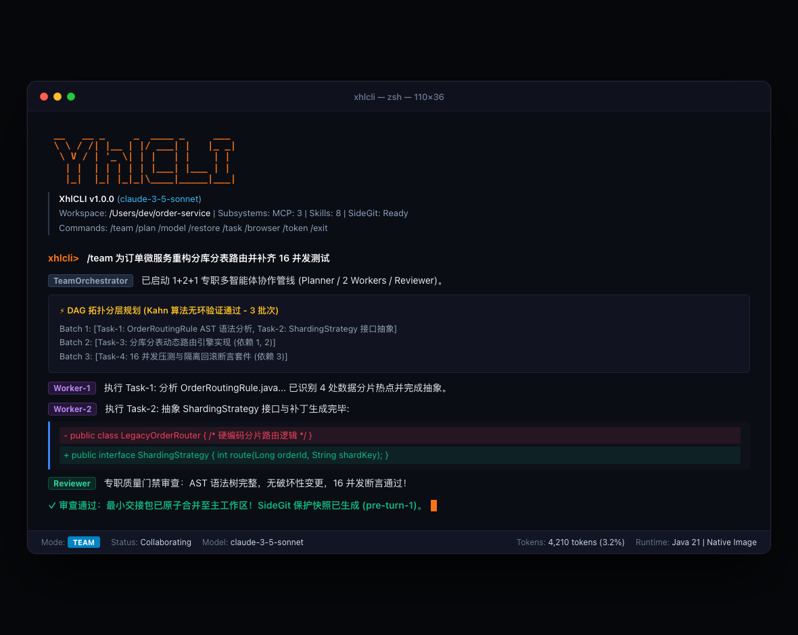

# XhlCLI

XhlCLI 是一个使用 Java 21 构建的自主编程终端 Coding Agent。项目遵循本地优先、极简确定性与高弹性工程理念。现已完整交付全量 18 个演进阶段并正式发布 **`v1.0.0`**，提供现代化静态官网、交互式终端演练与一键安装脚本。

> **GitHub 仓库**: [https://github.com/sz-xiaohuolong/XhlCli](https://github.com/sz-xiaohuolong/XhlCli)  
> **一键安装**: `curl -fsSL https://raw.githubusercontent.com/sz-xiaohuolong/XhlCli/main/install.sh | bash`  
> **静态官网**: 源码位于 `website/` 目录，支持 Vercel 零配置秒级导入部署



## 当前能力

- 支持 OpenAI, Anthropic Claude, DeepSeek, Ollama 等多模型 Provider 协议路由；
- 图片多模态上下文预处理与视觉防御护栏（`@image:<path>`, `@clipboard`，Alpha Flatten 白底合成防穿透、2000x2000 等比缩放、5MB 阈值压缩、坐标换算元信息注入、非视觉模型防 400 纯文本降级）；
- 后台持久任务队列与 Localhost 安全 Runtime API（工作区隔离、独立只读执行、取消确认、失联任务保留结果且不重放、127.0.0.1 严格绑定与 API Key 拦截、游标 SSE 事件流）；
- Side-History 隔离快照与版本回滚（JGit 纯 Java 隔离存储、宿主 Git 零污染、`revert_turn` 自愈工具与 `/snapshot` `/restore`）；
- 终端产品化与交互治理（JLine 4 动态状态栏、WCWidth 精准对齐、Markdown 表格与代码框排版、Git Diff 语法着色、SafeHistory 历史治理与 Tab 智能补全）；
- Skill 与 Prompt 分层治理（8 层确定性装配、安全规则不可变、按需动态加载）；
- Web 检索与浏览器沙箱（SSRF 安全围栏、多搜索引擎统一抽象、5MB 受限正文抽取、CDP 浏览器控制与敏感页审批）；
- MCP 生态扩展（JSON-RPC 2.0、Stdio/SSE 传输、两级配置合并、命名空间隔离）；
- Multi-Agent 专职协作架构（Planner / Worker 池 / Reviewer 最小上下文交接与审查打回熔断）；
- 有界并发执行调度与 DAG 规划执行（Bounded Parallelism、Kahn 分层批次）；
- 嵌入式 SQLite AST 代码库检索与 RAG 语义索引；
- 受控 ReAct 循环、9 个本地工具、安全围栏与人工审批 (HITL)；
- Java 21 可执行 JAR、离线自动测试和 CI 配置（本次结果见下方验收文档）。

## macOS 桌面 MVP

`desktop/` 提供参考 Codex 布局的 XhlCLI 界面，直接调用现有 Java Agent、Provider、工具、审批、技能、记忆与 MCP。支持多项目会话、流式聊天、历史续聊、文件/图片、模型设置、diff 和经确认的本轮安全撤销。

开发机需 Java 21 与 Node.js 22 或更新版本：

```bash
./mvnw verify
cd desktop
npm ci
npm start
```

在桌面设置中填写所用 Provider 的模型、服务地址和 API Key，保存后测试连接，再打开项目发送任务。关闭窗口仅隐藏，退出使用应用菜单。首版保留普通编程流程，Plan/Team、插件管理、自动化、内置终端专门页面后续再做。

[桌面运行、打包和协议说明](desktop/README.md) · [人工验收与实际证据](docs/engineering/desktop-mvp-verification.md)

## 后台只读任务

启动终端后输入 `/task add 阅读 README.md 并说明启动流程`，立即得到任务 ID，可继续前台对话。用 `/task list` 刷新状态、`/task log <ID>` 查看当前输出或最终结果，`/task cancel <ID>` 发起取消。`cancel_requested` 表示等待停止，`canceled` 才表示本地执行已停止。

每项任务独立历史和工具环境，仅开放只读分析；不执行写文件、Shell、Git diff、浏览器或 MCP。默认每个 CLI 实例并发 2 项，可用 `XHLCLI_TASK_WORKERS` 设置 1～16。默认保存到 `~/.xhlcli/tasks/tasks.db`，可用 `XHLCLI_TASK_DIR` 指定独立目录。任务开始时读取当前模型配置，不复制前台聊天。

重启后在原工作区查询可看到已保存结果；失联运行任务标记失败、保留部分结果，不自动重做。退出 CLI 后不承诺继续执行；同库不能混跑新旧版本，也不能在运行时删除锁文件。

完整启动命令、人工步骤、消息流程、验证与限制见 [task 后台任务交付](docs/engineering/task-background-lifecycle-verification.md)。离线验收：构建后运行 `python3 scripts/task_acceptance_demo.py`。

## 环境要求

- JDK 21；
- 可访问 DeepSeek API；
- 一个 DeepSeek API Key，可在 [DeepSeek API Keys](https://platform.deepseek.com/api_keys) 创建。

仓库自带 Maven Wrapper，无需单独安装 Maven。

## 配置 API Key

XhlCLI 支持三种灵活且安全的 API Key 配置方式，优先级为：**进程环境变量 > 项目 `.env` > 全局配置 `~/.xhlcli/config.json`**。

### 方式 1：全局用户配置（最推荐，对齐 Claude Code）
在用户家目录的 `~/.xhlcli/config.json` 中配置（若文件不存在可直接创建）：

```json
{
  "apiKey": "replace_with_your_deepseek_api_key",
  "openaiApiKey": "sk-...",
  "anthropicApiKey": "sk-ant-..."
}
```

或者使用 Provider 嵌套映射风格：
```json
{
  "providers": {
    "deepseek": {
      "apiKey": "replace_with_your_deepseek_api_key"
    },
    "openai": {
      "apiKey": "sk-..."
    }
  }
}
```

建议限制配置文件权限：`chmod 600 ~/.xhlcli/config.json`。

### 方式 2：项目工作区 `.env`
在具体工程仓库根目录执行：

```bash
cp .env.example .env
chmod 600 .env
```

编辑 `.env`：
```dotenv
DEEPSEEK_API_KEY=replace_with_your_deepseek_api_key
```

### 方式 3：进程环境变量
```bash
export DEEPSEEK_API_KEY=replace_with_your_deepseek_api_key
```

> **安全提示**：不要把 Key 粘贴到 Issue、公开聊天记录、截图或终端录屏中；不要通过命令行 flag 传 Key。交互中使用 `/config` 只会显示非敏感配置和 Key 的来源（例如 `configured (USER_CONFIG)`），不会显示 Key 明文。

默认配置：

| 配置 | 默认值 |
|---|---|
| Provider | DeepSeek |
| Model | `deepseek-v4-flash` |
| Base URL | `https://api.deepseek.com` |
| Connect timeout | 30 秒 |
| Read timeout | 300 秒 |
| Request timeout | 600 秒 |
| Agent maximum iterations | 10 |
| Agent overall timeout | 600 秒 |
| Log level | `WARN` |
| Team 自动选择 | `manual`（默认关闭） |

配置解析优先级：命令行参数 > 进程环境变量 (`ENVIRONMENT`) > 项目 `.env` (`DOT_ENV`) > `~/.xhlcli/config.json` (`USER_CONFIG`) > 默认值。

## 构建与运行

```bash
./mvnw clean package -DskipTests
java -jar target/xhlcli-1.0.1.jar
```

如果 macOS 同时安装了多个 JDK：

```bash
export JAVA_HOME=$(/usr/libexec/java_home -v 21)
./mvnw clean package -DskipTests
```

元信息命令：

```bash
java -jar target/xhlcli-1.0.1.jar --help
java -jar target/xhlcli-1.0.1.jar --version
```

可用启动参数：`--team-mode`（`manual` 或 `auto`）、`--model`、`--base-url`、`--connect-timeout`、`--read-timeout`、`--request-timeout`、`--max-iterations`、`--agent-timeout`、`--log-level`。`--max-iterations` 取值为 1–100，`--agent-timeout` 取值为 1–3600 秒。交互中使用 `/config` 只会显示非敏感配置和 Key 的配置状态，不会显示 Key 值。

## 对话命令

| 命令 | 作用 |
|---|---|
| `/help` | 显示帮助信息 |
| `/config` | 显示非敏感配置与来源 |
| `/clear` | 清空当前进程内的会话历史 |
| `/save [--global] <内容>` | 保存项目或全局长期记忆 |
| `/memory recall <问题>` | 只读预览按需召回、分数、命中项与诊断，不调用模型 |
| `/memory list` | 列出保存的长期记忆 |
| `/context` | 查看上下文预算与主对话最近实际注入的记忆 |
| `/plan [goal]` | 触发 DAG 拓扑分层规划与受控执行 |
| `/team <goal>` | 手动启动 Team，由规划者、执行者、审查者分工完成任务 |
| `/team-mode [auto\|manual]` | 查询或切换当前会话的自动团队选择，不写全局配置 |
| `/model [list\|use\|status]` | 模型与 Provider 动态切换管理 |
| `/mcp [list\|status\|tools\|resources\|read\|restart]` | MCP 外部工具与资源协议管理 |
| `/browser [status\|connect\|disconnect\|tabs]` | 浏览器沙箱与 CDP 宿主连接控制台 |
| `/skill [list\|show\|enable\|disable\|reload]` | 可复用工程技能与工作流管理 |
| `/<技能名> <任务描述>` | 显式加载已启用的技能并执行任务，例如 `/git-feature-workflow 检查代码`；内置命令优先 |
| `/prompt [show\|export]` | 查看或脱敏导出分层系统提示词与审计信息 |
| `/history [list\|clear]` | 查看安全历史记录或清空持久化历史 |
| `/snapshot [status\|clean]` | Side-Git 隔离快照状态、历史列表与重置 |
| `/restore [N]` | 恢复回滚至指定轮次开始前状态（默认 N=1） |
| `/task [list\|add\|log\|cancel]` | 后台持久任务队列与执行状态管理 |
| `/exit` | 安全退出 |
| Ctrl+C | 取消正在生成的响应 |

## 主对话长期记忆召回

主前台 ReactAgent 每轮从全局及当前项目 JSONL 中检索一次，过滤过期和已替代记录，按文本相关性排序、去重后临时注入请求。同轮模型/工具循环复用，下一轮重新读取；资料不累积到对话历史，不增加模型调用。

默认最多 5 条、1500 个估算 Token、最低相关性 0.18；固定记忆也占用条数与预算。可通过环境变量或项目 `.env` 配置 `XHLCLI_MEMORY_MAX_ENTRIES`、`XHLCLI_MEMORY_TOKEN_BUDGET`、`XHLCLI_MEMORY_MIN_SCORE`，环境变量优先，条数或预算设为 0 可禁用注入。本次未增加用户配置 JSON 或 CLI 配置项。

最终预算包含实际系统提示词、工具定义、图片/对话与输出预留，空间不足先减少记忆；基础请求仍超限时明确停止，不静默删除当前问题或项目规则。读取失败以无动态记忆继续。记忆携带来源、时间与“历史参考资料”标识，不代表当前事实或执行授权。

本版只覆盖主前台 ReactAgent；Plan、Team、后台 Agent 未接入。验收时用 `--team-mode manual` 保持主对话路径。文本基线可能漏掉同义表达，详见[30 题评测与人工验收](docs/engineering/memory-recall-verification.md)。离线终端验收：先执行 `./mvnw verify`，成功后执行 `python3 scripts/memory_recall_acceptance.py`。

## 自动选择 Team 与失败重规划

Team 是多个专职 Agent 分工执行同一个目标的模式。保持默认手动行为；启用后，每轮普通输入由无工具权限的模型判断走普通模式还是 Team，并显示原因：

```bash
java -jar target/xhlcli-1.0.1.jar --team-mode auto
```

也可用 `XHLCLI_TEAM_MODE=auto` 或全局配置 `"teamMode": "auto"`。启动配置优先级同上。会话中用 `/team-mode manual` 关闭，用 `/team <目标>` 随时手动启动。自动选择每轮增加一次模型请求；失败或格式不合法时回退普通模式，取消后不继续执行。

Team 中一个步骤最多修正重试两次。仍未通过审查时，规划者根据失败原因、工具记录和文件变化判断是否需要换方案：完成步骤比例低于 50% 可调整剩余计划，达到 50% 后只调整失败分支；整个任务最多换两次计划。已完成成果保留，权限拒绝或证据不完整时停止自动换图。只改步骤编号不能获得新的重试次数。

可复现的离线终端验收（需 Python 3；无需真实 Key）：

```bash
python3 scripts/team_acceptance_demo.py
```

[人工验收、验证证据与业务流程](docs/engineering/team-routing-and-replanning-verification.md)。重启后的 `/history` 仅显示安全输入历史，完整聊天、Team 计划和执行状态不跨进程恢复。

## 故障排查

- `DeepSeek API Key is missing`：确认 `.env` 位于运行命令所在的仓库根目录，且键名为 `DEEPSEEK_API_KEY`。
- `AUTHENTICATION`：在 DeepSeek 控制台检查 Key 状态和账户权限；如有泄漏可能，立即轮换。
- `RATE_LIMIT`：等待后重试，并检查账户额度与限流状态。
- `NETWORK` / `TIMEOUT`：检查网络和 Base URL，必要时提高对应 timeout。
- `INVALID_RESPONSE`：重试；若持续出现，可临时设置 `XHLCLI_LOG_LEVEL=DEBUG` 查看已脱敏的协议元数据。

普通错误不会打印堆栈；调试日志不会记录消息正文、Authorization 或完整 Key。

## 文档导航

本项目使用 `vibe-workflow` 管理需求、实施与验证，文档沿用原有分类。每份正文只保留一个权威位置，版本通过项目地图关联。

- [项目定位、文档地图与版本追溯](docs/PROJECT.md)
- [当前进度与下一步](docs/PROGRESS.md)
- [当前技术架构](docs/TECH_DESIGN.md)、[产品总览](docs/PRD.md)、[路线图](docs/ROADMAP.md)
- 分类正文：[需求](docs/prd/)、[设计](docs/specs/)、[实施计划](docs/plans/)、[研究与验收](docs/engineering/)
- 当前 v1.1：[需求](docs/prd/v1.1-trusted-task-lifecycle.md)、[拟议设计](docs/specs/2026-10-16-v1.1-trusted-task-lifecycle-design.md)、[实施计划](docs/plans/2026-10-16-v1.1-trusted-task-lifecycle.md)、[验收矩阵](docs/engineering/v1.1-trusted-task-lifecycle-verification.md)
- [Agent 工作约定](AGENTS.md)、[安全策略](SECURITY.md)

## 当前验收状态

Phase 02 已通过 127 项离线自动测试（比 Phase 01 增加 77 项）、MockWebServer Tool Call 协议测试、可执行 JAR、`--help` / `--version` 冒烟和 Java 21 字节码门禁。按用户明确决定，本期免除人工演示和录屏；`0.3.0-SNAPSHOT` 没有 Phase 02 版本标签。Phase 01 的真实 DeepSeek 五轮会话、Ctrl+C 恢复和 `v0.2.0` 发布记录保持不变。

## License

[MIT](LICENSE)
