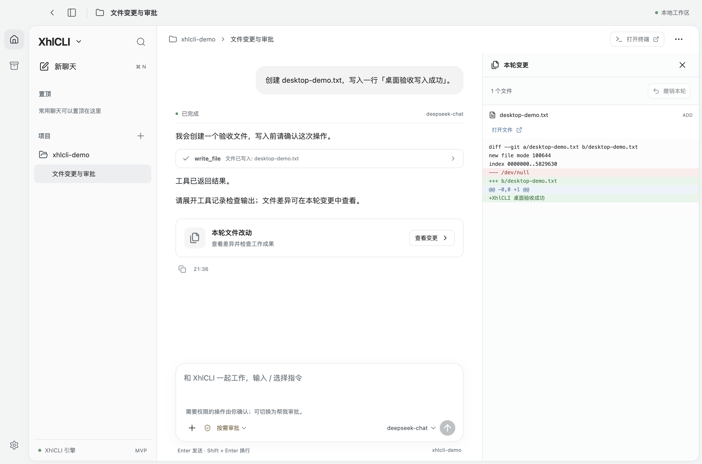

# XhlCLI

XhlCLI 是一个运行在本机的 AI 编程助手，提供 **macOS 桌面端**和 **CLI 终端入口**。用自然语言描述任务，让它阅读代码、修改文件、执行命令，再检查工具记录和文件变更。

桌面端与 CLI 共用 Java 执行引擎，支持 DeepSeek、OpenAI、Anthropic 和 Ollama。项目会话与配置保存在本机；使用远程模型时，请求会发送到你配置的模型服务。

[快速开始](#快速开始) · [主要能力](#主要能力) · [使用文档](#使用文档) · [问题反馈](https://github.com/sz-xiaohuolong/XhlCli/issues)



*真实桌面应用截图：使用隔离演示项目和本地测试模型，文件写入、审批与差异查看均由实际引擎完成。*

## 快速开始

### macOS 桌面端

开发运行需要 **Java 21** 和 **Node.js 22 或更新版本**，仓库自带 Maven Wrapper。

```bash
git clone https://github.com/sz-xiaohuolong/XhlCli.git
cd XhlCli
./mvnw -DskipTests package
cd desktop
npm ci
npm start
```

1. 添加一个项目目录。
2. 进入“设置 → 模型与连接”，选择模型提供方，填写模型名称、服务地址和自己的 API Key，保存并测试连接。使用 Ollama 时配置本地服务即可。
3. 新建聊天，描述任务；需要权限时确认操作，完成后查看本轮变更。按 Enter 发送，Shift + Enter 换行，输入 `/` 查看和补全指令。

**已有桌面压缩包？** Apple 芯片 Mac 可解压 `XhlCLI-0.1.0-mac-arm64.zip`，将 `XhlCLI.app` 拖入“应用程序”后打开。该分发包内置 Java，无需另外安装 Java、Node.js 或使用终端。生成压缩包、首次打开及平台限制见 [桌面运行与分发说明](desktop/README.md)。

桌面分发目标为 macOS 13+ / Apple Silicon，目前只完成本机 Apple Silicon 验收；没有 Developer ID 签名、公证或自动更新。Windows、Intel Mac 和旧版 macOS 尚未实机验收。

### CLI 终端

CLI 需要 Java 21，当前启动入口使用 DeepSeek。先在仓库根目录构建，再进入要操作的项目运行：

```bash
./mvnw -DskipTests package
export DEEPSEEK_API_KEY="你的 API Key"
java -jar target/xhlcli-1.0.1.jar
```

从其他目录启动时，将 JAR 路径改为绝对路径；启动时所在目录就是工作区。进入对话后用 `/help` 查看命令，用 `/model list` 查看可切换的已配置模型。桌面端可直接选择其他提供方，不要求额外配置 DeepSeek。

<details>
<summary>其他配置方式与优先级</summary>

CLI 也可从项目 `.env` 读取 `DEEPSEEK_API_KEY`，或在 `~/.xhlcli/config.json` 保存配置。桌面设置写入同一个全局配置文件，例如：

```json
{
  "providers": {
    "deepseek": {
      "apiKey": "你的 API Key",
      "model": "deepseek-v4-flash",
      "baseUrl": "https://api.deepseek.com"
    }
  }
}
```

模型配置的优先级为：进程环境变量 > 项目 `.env` > 全局配置 > 默认值；CLI 的非敏感启动参数优先级更高。若桌面保存后配置未生效，先检查环境变量和项目 `.env`。API Key 不通过命令行参数传入；配置文件应限制为本人可读写。

查看 CLI 参数：`java -jar target/xhlcli-1.0.1.jar --help`。对话中 `/config` 显示非敏感配置及来源。

</details>

## 主要能力

| 你要做什么 | 当前源码提供的能力 |
|---|---|
| 理解和修改项目 | 文件读取、文本与代码检索、写入与补丁、命令执行；可查看工具参数和实际结果 |
| 管理多个项目与聊天 | 桌面侧栏按项目组织会话，支持搜索、重命名、置顶、归档与恢复；重启后可继续原对话 |
| 控制执行权限 | 默认“按需审批”；桌面可按聊天切换“帮我审批”，自动批准工具调用，包括命令执行。路径与命令硬策略仍然生效 |
| 检查和撤销改动 | 桌面展示每轮文件差异，确认后撤销；发现同一文件后来被改动时拒绝撤销，保留现有内容 |
| 规划复杂任务 | `/plan <目标>` 先生成计划再确认执行；`/team <目标>` 由规划、执行和审查角色协作 |
| 复用技能与外部工具 | 管理技能，通过 `/<技能名> <目标>` 显式调用；通过 MCP（连接外部工具与资源的协议）扩展项目能力 |
| 保存长期信息 | `/save` 保存项目或全局记忆，`/memory` 查看、搜索或预览召回；具体注入范围见 [记忆验收说明](docs/engineering/memory-recall-verification.md) |
| 使用文件和图片 | 桌面支持选择、拖入文件和粘贴 PNG；发送图片前检查模型是否支持视觉输入 |
| 并行处理只读分析 | CLI `/task` 后台独立分析，前台可继续对话；按工作区隔离，结果持久保存，支持取消与重启查询 |

桌面输入 `/` 会显示当前可用指令。CLI 还提供 `/task`、`/browser`、`/index`、`/search`、`/snapshot`、`/restore` 等终端命令；各入口的命令范围以自己的 `/help` 为准。

### 桌面执行与恢复边界

- 同一真实项目目录在桌面端同时只运行一个任务。工具审批、停止与执行结果都归属当前聊天。
- “帮我审批”按聊天保存，新聊天默认按需审批。切回按需审批只影响后续操作，不撤回已经批准的操作。
- 关闭窗口会隐藏应用；从应用菜单退出才会结束进程。停止或退出不会自动回滚已经产生的改动。
- 桌面保存完整会话以便续聊。CLI 的 `/history` 保存安全输入历史，不等于恢复完整聊天；后台任务结果由独立数据库保存。
- 桌面的“打开终端”会在当前项目目录启动系统终端。

### CLI 后台任务

```text
/task add 阅读 README.md，说明项目启动流程
/task list
/task log <任务ID>
/task cancel <任务ID>
```

后台任务有独立历史，仅开放只读分析，不提供写文件、Shell、Git diff、浏览器或 MCP 操作。`cancel_requested` 表示正在等待停止，`canceled` 才表示本地执行已停止。重启后可查看保存的结果；失联运行任务标记失败并保留部分输出，不自动重做。退出 CLI 后不保证继续运行。

配置、同库多实例限制和人工验收见 [后台任务使用与实现说明](docs/engineering/task-background-lifecycle-verification.md)。

## 使用文档

按要完成的事情选择入口：

- **使用桌面端、构建分发包或排查启动问题**：[桌面说明](desktop/README.md)；[人工验收步骤](docs/engineering/desktop-mvp-verification.md)。
- **开启 CLI 自动 Team 或理解失败重规划**：[Team 使用与验收](docs/engineering/team-routing-and-replanning-verification.md)。
- **验证记忆召回、后台任务行为**：[记忆说明](docs/engineering/memory-recall-verification.md)；[task 说明](docs/engineering/task-background-lifecycle-verification.md)。
- **参与开发、理解模块和查找规划**：[项目与文档地图](docs/PROJECT.md)；[技术设计](docs/TECH_DESIGN.md)；[当前进度](docs/PROGRESS.md)；[Agent 工作约定](AGENTS.md)。
- **报告安全问题**：[安全策略](SECURITY.md)。普通问题请提交 [Issue](https://github.com/sz-xiaohuolong/XhlCli/issues)，附上复现步骤、系统版本和脱敏日志。

## 开发与验证

```bash
# 仓库根目录：Java 测试与打包
./mvnw verify

# 桌面桥接与界面构建（先执行过 npm ci）
cd desktop
npm test
npm run build
```

离线演示与功能验收使用本地模拟模型，不消耗真实模型额度；运行方式及验证范围见对应文档。

## 许可证

[MIT](LICENSE)
