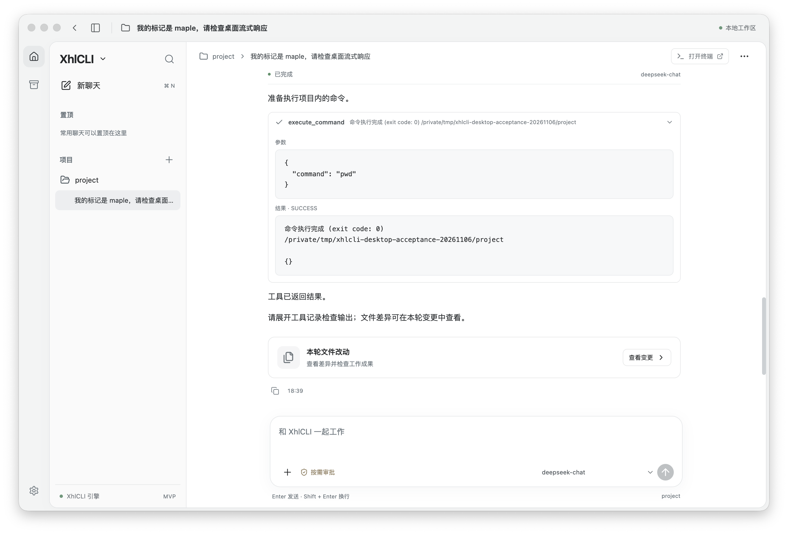
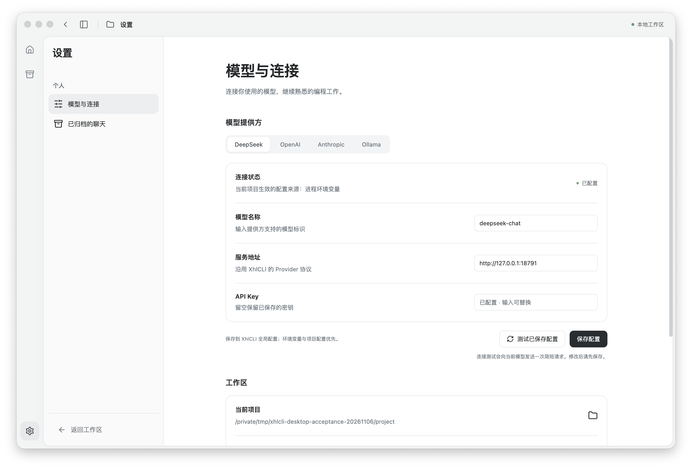
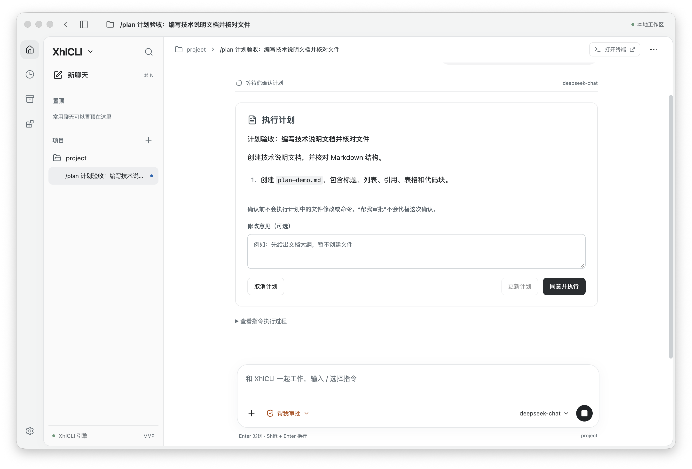
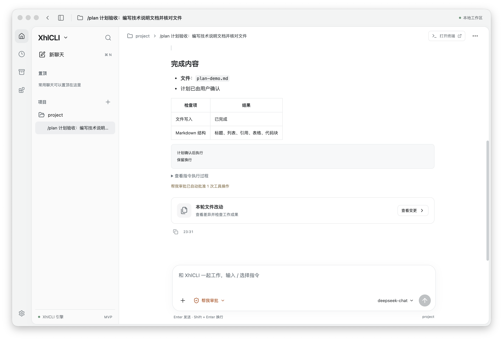

# 桌面 MVP 验收与人工操作步骤

2026-11-06，桌面核心闭环在 macOS 26.6.2 / Apple Silicon 上完成离线验收。界面参考用户提供的主聊天与设置截图，通过 Electron/React 适配现有 Java Agent；本次没有重新实现模型、工具或编程引擎。

Java 全量回归 620 项、Node 桥接 2 项通过，前端构建和本机 `.app` 打包成功。真实图形操作覆盖项目添加、发送与流式、审批允许/拒绝、停止、差异与撤销、配置连接、重启续聊、文件附件、聊天管理和外部终端。模型响应来自本地测试服务，工具、持久化和快照均为真实实现。真实收费 Provider、其他硬件和所有故障组合未覆盖，不能据此宣称全功能 Codex 等价或跨平台发布就绪。

依据：[需求与 AC](../prd/desktop-codex-ui.md) · [设计](../specs/2026-11-06-desktop-mvp.md) · [任务 D1～D5](../plans/2026-11-06-desktop-mvp.md) · [启动与私有协议](../../desktop/README.md)。

## 1. 自动化与产物

| 检查 | 实际结果 | 证据入口 |
|---|---|---|
| `./mvnw -q verify` | 620 项，失败 0、错误 0、跳过 0；退出码 0 | `target/surefire-reports/TEST-*.xml`；本地最终日志 `/tmp/xhlcli-desktop-acceptance-20261106/maven-verify-final.log` |
| `cd desktop && npm test` | 2 项通过：响应配对与增量事件；后端退出时拒绝挂起请求 | [桥接测试](../../desktop/test/bridge.test.cjs) |
| `cd desktop && npm run build` | 通过 | [构建脚本](../../desktop/scripts/build.mjs) |
| `cd desktop && npm run package` | 退出码 0；最终应用实际启动并完成续聊、附件等操作 | `desktop/release/mac-arm64/XhlCLI.app`；本地 `package.log` |
| impeccable 检查 | 首轮检查结果为 `[]`；修正文字对比度后完成一次主界面与设置页确认 | 下方截图；本地 `impeccable.json` |
| 独立代码审查 | 六项发现均修复，复核没有剩余 Critical / Important | 本节下方修复记录 |

本机日志和运行数据不提交 Git；可用仓库中的测试与 [离线模型脚本](../../scripts/desktop_acceptance_fixture.py) 复现。`.app` 包含当前 Java JAR，仍依赖本机 Java 21；未签名、未公证、使用默认 Electron 图标，没有创建 Release 或自动更新渠道。

审查修复与回归：

- 撤销同时检查文件本身及祖先目录的符号链接，拒绝通过链接改写项目外文件。
- 文本输入与文本附件不展开终端的 `@image` / `@clipboard` 宏；只有显式图片附件产生图片载荷。
- 命令取消会终止捕获的后代进程，等待退出并移除取消监听，避免界面已取消但子进程继续写入。
- 最终回答、事件与保存的上下文均脱敏；按 JSON 文本节点处理，避免破坏协议结构。
- 工具详情使用真实 `argumentsJson`，最终包中已展开并看到 `{"command":"pwd"}`。

## 2. 验收覆盖

“通过”只指表中实际运行的范围；未覆盖的分支单独列明。后端自动化是集成测试与真实文件操作，不等同于所有路径都经过 GUI。

| AC | 证据与结果 | 覆盖边界 |
|---|---|---|
| D01～D02：项目绑定、添加 | GUI 从原生选择器添加隔离目录；命令返回正确项目路径；`DesktopServiceTest` 检查会话隔离 | 两个不同项目同名文件读取、不可访问目录的 GUI 分支未单独验收 |
| D03：视觉基线 | 浅色框架、窄功能栏、项目侧栏、居中聊天、底部输入框、分组设置已核对 | 以用户截图及 MVP 范围为准，不做逐像素承诺 |
| D04～D05：历史与续聊 | 退出开发版后启动最终包，历史、工具结果及撤销记录仍在；“验收续聊”回答找到之前的 maple；`DesktopServiceTest` 检查续聊请求和会话隔离 | 图片上下文继续采用原引擎的裁剪规则 |
| D06：中断恢复 | `DesktopStoreTest` 验证未结束轮次重开标为 interrupted；状态损坏拒绝覆盖；重复进程文件锁拒绝 | 未人为断电或强杀整个系统 |
| D07：真实增量 | GUI 在结束前看到分段文本；`DesktopServiceTest` 在 running 时收到 TextDelta 后取消 | 未作网络延迟性能基准 |
| D08：文本附件 | 最终包使用原生选择器添加 README；聊天出现附件，实际请求包含文件名和正文 | 失效文件的 GUI 错误分支未单独验收 |
| D09：图片 | `DesktopServiceTest` 验证显式图片生成 `data:image/`；非视觉模型拒绝；文本宏不触发图片读取 | 没有向真实视觉模型发送图片；拖放与粘贴未单独 GUI 验收 |
| D10：同目录串行 | `DesktopServiceTest` 在审批等待时提交第二会话，明确拒绝，并检查会话历史不串线 | 不承诺 CLI 或外部编辑器也受桌面互斥锁约束 |
| D11：工具审批 | GUI 批准前文件不存在，批准后出现；另一次拒绝后没有写入；命令审批与输出通过 | 只批准当前操作 |
| D12～D13：取消、过期审批 | GUI 停止流式显示已停止；自动化验证取消事件、重复审批拒绝、命令后代进程不再写文件 | “审批等待中取消”的 GUI 分支未单独运行 |
| D14：失败反馈 | GUI 显示工具拒绝结果；Node 验证后端退出不会无限等待 | 网络、磁盘及所有 Provider 错误组合未穷举 |
| D15～D16：保守撤销 | `DesktopChangesTest` 验证保留用户原有内容、无关文件、Git 索引与执行权限；后来编辑相同文件则拒绝整轮撤销 | 多文件恢复不承诺抵御外部程序并发写入的原子性 |
| D17～D18：差异与确认 | GUI 新增文件 diff 正确，原生确认后撤销且文件消失；自动化覆盖新增、修改、删除与链接替换 | 二进制渲染、取消确认、磁盘中途写失败未单独 GUI 验收 |
| D19：Provider 解耦 | 图片集成测试只配置 OpenAI，仍能运行两轮；不要求无关 DeepSeek Key | 采用本地兼容协议服务 |
| D20：设置与测试 | GUI 保存配置、测试已保存配置并显示连接成功；配置自动化验证环境优先级和其他设置保留 | 真实认证失败、断网场景未单独 GUI 验收 |
| D21：模型记录 | 每轮显示实际模型；配置测试验证保存的默认模型用于新会话 | 执行途中切模型的 GUI 分支未单独运行 |
| D22：凭据保护 | `DesktopConfigTest` 验证接口不返回 Key、留空保留；`DesktopServiceTest` 验证最终回答、事件、历史脱敏且协议不损坏 | 不把已知 Key 脱敏当作任意敏感数据识别能力 |
| D23：外部终端 | 最终包打开 Terminal，新 Shell 提示为 project，进程 cwd 核对为隔离项目真实路径 | 外部终端安装/启动异常未单独制造 |

聊天管理补充：最终包完成重命名、归档、归档列表查看及恢复，记录保持完整。

主界面与设置截图仅含隔离测试数据：





## 3. 人工验收步骤

### A. 启动

本机产物位于仓库的 `desktop/release/mac-arm64/XhlCLI.app`，已安装 Java 21 时可双击。源码启动、重新打包及无账号的隔离验收命令见 [desktop/README.md](../../desktop/README.md)。使用真实 Provider 时先在“设置 → 模型与连接”选提供方，输入模型、服务地址和 API Key，保存后点“测试已保存配置”。

建议用一个临时 Git 项目完成下面的写入与撤销检查。进程环境变量和项目 `.env` 会优先于图形设置中的全局配置，当前来源会显示在设置页。

### B. 核心闭环

| 步骤 | 操作 | 应观察到的结果 |
|---|---|---|
| 1 | 点击项目旁的加号，选择目录，新建聊天 | 侧栏出现项目；顶部、输入框底部显示当前项目 |
| 2 | 发送“记住本次标记 maple，并简短介绍这个项目” | 内容增量出现；结束时显示完成状态及模型 |
| 3 | 请求“创建 desktop-demo.txt，写入一行验收成功” | 写入前出现审批；先拒绝，确认文件未创建；再次请求并允许，文件才出现 |
| 4 | 展开工具记录，点击“查看变更”，选择文件 | 看到实际参数、工具结果及新增内容的 diff；可打开文件 |
| 5 | 点击撤销，先选“保留改动”，再重新操作并确认撤销 | 第一次文件不变；第二次恢复该轮之前的状态 |
| 6 | 再让 Agent 修改测试文件，然后在编辑器追加自己的内容，再尝试撤销 | 显示冲突，自己后来写入的内容保留 |
| 7 | 请求执行 `pwd`，按提示批准；再点击顶部“打开终端” | 工具输出和外部终端目录都对应当前项目 |
| 8 | 用加号添加文本文件并要求读取；选择视觉模型后添加图片 | 输入区显示附件；模型能使用附件；非视觉模型发送图片时应保留输入并提示切换 |
| 9 | 发起较长回复或操作，点击停止；再发起一轮等待审批并停止 | 先显示停止请求，执行端确认后显示已停止；旧审批不能再放行 |
| 10 | 同一项目创建第二聊天，在第一聊天运行时尝试发送 | 第二项执行被拒绝并保留输入；第一聊天继续运行 |
| 11 | 从应用菜单“退出 XhlCLI”，重新打开原聊天，询问之前的标记 | 历史、工具和改动记录仍在；模型可继续原对话，不自动重跑旧任务 |
| 12 | 在聊天菜单重命名、置顶、归档，打开左侧归档列表并恢复 | 侧栏和标题更新，恢复后的消息不丢失 |

离线测试模型仅按固定触发词回复，不会理解任意自然语言任务；使用它时以 README 列出的“验收写入”“验收命令”“验收停止”“验收续聊”为准。真实模型的输出质量由人工验收补充，不属于本次离线证据。

### C. 已知交付边界

- 首版为 macOS 普通编程聊天。Plan/Team 专门界面、自动化、插件页、内置交互终端、Git 提交/推送/PR 和 worktree 管理不在本次范围。
- 关闭窗口会隐藏应用；退出应用才会结束执行。退出或取消不会自动回滚已经发生的文件改动。
- 快照排除路径（如 `.env`、`.xhlcli`、依赖与发布产物）不能依靠本轮撤销恢复。撤销期间应避免其他程序写同一批文件。
- 目前只实测 Apple Silicon；Java 运行时未随包分发，安装分发、签名、公证及 Intel 兼容属于后续工作。

## 4. 交付记录

本次基线为 `837a10c8ca08ba93a6feeda72efe1c5c996c800b`。实现提交 `f0daa4b509664a460ac8d3f87e41cd04efae093d` 已按授权推送 `origin/main`，远程 SHA 核对一致。首次 GitHub CI `42206970581` 在流式测试失败；修复提交 `ad74911f92eaf9eeaa2eeff6545b362bfb887125` 已推送，远程 SHA 核对一致。随后 CI `42207480060` 成功，Java Verify、桌面桥接测试、前端构建和 JAR 冒烟均通过。本次只同步代码与文档，不打 Tag、不发布新版本。

当前 `.app` 内 JAR 与本机全量回归构建出的 JAR 的 SHA-256 一致：`3e5e3f87b46f8030368b28a1a54744f8eafee9294f68b2059f36184ac42f1936`。本次变更的 214 条本地 Markdown 链接及 `git diff --check` 通过；高置信凭据模式扫描没有命中新增内容，依赖、构建产物与验收运行数据均未提交。

首次 CI 的流式测试在 15 秒内未收到 TextDelta。本地使用长输入重现；原因是测试服务的排队限速同时作用于请求上传，尚未读完请求就耗尽了测试等待时间。改用 Dispatcher，在请求完整到达后仅限速响应，并保留长输入回归。修复前该场景失败；修复后 `DesktopServiceTest` 5 项全部通过，流式取消场景约 0.5 秒。生产代码与已验收 `.app` 未改变，不以放宽超时或跳过测试处理失败。


## 5. 审批模式增量验收（2026-11-06）

本次修复原输入区“按需审批”静态文字，补齐会话级选择、保存和真实执行。范围由用户本次请求确定，不修改以上桌面 MVP 发布历史。

- TDD：新增默认/保存/校验/隔离测试在实现前失败（预期 `on-request`，实际缺字段）；实现后通过。
- `./mvnw verify`：627 项通过，0 失败/错误/跳过；随后仅新增保存失败、活动轮次状态一致性和取消回归，`./mvnw test -Dtest=DesktopServiceTest` 9 项通过。后一次没有修改生产 Java 代码，沿用前次全量证据。
- Java 覆盖：创建/切换/重启恢复、旧数据兼容、非法模式拒绝、会话隔离、自动写入、路径越界拒绝、等待中切换后继续、切回重新审批、过期审批拒绝、取消不复活、磁盘保存失败不放行。
- `npm test` 2 项桥接测试通过；`npm run build` 通过；impeccable 针对修改的 JSX/CSS 检测没有发现问题。
- 真实 Electron + 真实 Java 子进程 + 隔离 home/project + 本地 HTTP 模型：通过界面选择、发送执行，验证自动写入文件、自动 `pwd` 命令、切回人工和等待中再开启自动、设置页同步、新聊天默认按需、原聊天模式恢复、关闭并重启后历史/模式保留。使用真实文件系统保存故障验证错误显示和选项恢复。新聊天切换未丢失已输入草稿。
- 1360×900、900×620 真实窗口截图检查通过；控件、提示和发送入口可见。截图与运行脚本暂存于 `output/playwright/approval-mode/`，可重建，不提交。
- `npm run package` 生成本机 `desktop/release/mac-arm64/XhlCLI.app`；已从打包应用实际启动并验证历史恢复和审批切换，包内 JAR 与通过全量验证的 JAR SHA-256 一致。未签名、不发布、不推送。真实收费 Provider 和其他平台不在本次验证范围。

人工复验：退出旧版应用，打开新 `.app`；点击输入框的审批下拉选择“帮我审批”，发送文件写入任务，应直接执行并出现自动审批记录；切回“按需审批”后再次请求写入，应显示允许/拒绝卡片。新聊天保持默认按需审批。


## 桌面压缩包增量验收（2026-11-06）

本节补充新的分发包事实；前文关于依赖系统 Java 与历史 `.app` 的结论仅适用于当时的包。

- 用户确认目标为 Apple 芯片 Mac，朋友在设置页填写自己的 API Key；内置 Electron 和 Temurin Java 21.0.13+9，不携带开发者配置、密钥与聊天。
- 产物：`desktop/release/XhlCLI-0.1.0-mac-arm64.zip`，附同名 `.sha256`；包内有 `XhlCLI.app`、中文快速开始说明、Java 许可与对应官方源码。大小约 300 MiB。
- 本次构建包含工作区已有的审批模式修复；分发实现没有改动这些待提交代码，628 项 Java 全量回归通过。Node 5 项通过；其中运行环境测试先复现 2 项失败，再验证包内 Java 优先、路径空格、缺失环境报错和开发配置兼容。
- `npm run distribute` 成功；官方 JRE 与源码通过固定 SHA-256 检查。Java 保留官方签名，外层应用 ad-hoc 签名；打包目录和解压目录的 `codesign --verify --deep --strict` 均通过。
- 将 ZIP 解压至 `/tmp/XhlCLI 分发验收/`，以空白 home、`PATH=/nonexistent`、无效 `JAVA_HOME`/`XHLCLI_JAVA` 启动实际应用，agent-desktop 读到空项目主界面与设置页。进程树确认 Java 来自解压后的应用包。
- 使用解压后的 JRE 和 JAR，在独立 home/project 通过真实私有协议完成：空模型列表 → 保存测试 Key → 连接本地测试模型 → 创建项目/聊天 → 人工批准真实写入 → 查看 diff → 退出并恢复配置/聊天。全程不依赖系统 Java、Node 或 Git。
- 压缩包目录清单检查未包含 `.xhlcli`、`.env`、`.git`、日志与下载缓存；验收使用固定测试 Key，没有读取开发者真实密钥。
- 证据：`/tmp/xhlcli-distribution-java.log`、`/tmp/xhlcli-runtime-red.log`、`/tmp/xhlcli-distribution-build.log`、`/tmp/xhlcli-distribution-first-run.json`、`/tmp/xhlcli-distribution-settings.json`、`/tmp/xhlcli-distribution-smoke.log`。重现入口为 desktop README、`scripts/runtime-lock.json` 和现有本地模型夹具。
- 限制：设置页实际打开已验证，新增分发包的保存/连接闭环通过协议验证；未把本轮证据扩展为完整 GUI 全流程重测。真实收费 Provider、另一台 Mac、旧版 macOS 和带下载隔离标记的 Gatekeeper 首次打开未实机验收。未进行 Developer ID 签名、公证、自动更新或 Release 发布。


## 常用斜杠指令与升级续聊增量验收（2026-11-06）

本节对应 AC-D-CMD-01～05；沿用审批模式增量，不覆盖其历史结果。使用隔离 home/project、本地可控 HTTP 模型和 MCP 服务，没有调用真实收费模型。

- 新增 `DesktopCommandsTest` 7 项：无模型本地指令与保存、模型切换持久化、真实技能加载、Plan 规划/审批/执行/续问、Team 规划/执行/审查、HTTP MCP 初始化/资源读取/启停/重启、拒绝计划不执行。实现前目录查询因未知 `commands.list` 失败，实现后通过。
- 新增前端命令测试 2 项，先因缺少模块失败，后验证主/子命令筛选及模型需求分流；Node 共 7 项通过。最终 `./mvnw verify` 在当时工作区通过 650 项；包含同期其他任务的已有修改，不将它们计为本任务交付。日志 `/tmp/xhlcli-slash-package-verify.log`。
- 真实 Electron UI 发送九类指令，验证上下键、Tab、Enter、Escape、鼠标补全；MCP 资源读取、stop/status/start 状态保持；技能执行；记忆保存/搜索；模型选择；未知命令报错；Plan 拒绝与允许、Team 执行。测试脚本先修正新聊天按钮名称、下拉框定位及 MCP 状态枚举的断言，再继续未完成部分；未将脚本失败算作产品通过证据。
- 1360×900 与 900×620 窗口截图检查：菜单可滚动，候选、输入框和发送按钮未裁切。脚本与截图存于忽略目录 `output/playwright/slash-commands/`；UI 日志 `/tmp/xhlcli-slash-gui.log` 和 `/tmp/xhlcli-slash-gui-rest.log`。
- 使用保留的旧版 JAR，在新隔离用户目录写入含 maple 标记的聊天；退出后使用新版 JAR 读取同一状态文件，先成功调用新增命令目录，再续问并确认实际模型请求携带旧上下文。新版后端在 5 秒内正常退出。日志 `/tmp/xhlcli-upgrade-old.log`、`/tmp/xhlcli-upgrade-new.log`。
- 跨版本验收发现 HTTP MCP 自有 OkHttp 客户端未关闭，造成退出等待约 60 秒。新增关闭取消请求测试先超时失败；修复后与共享客户端仍可使用的测试通过。MCP、桌面命令及审批受影响回归共 20 项通过，后续全量验证仍通过。

- `npm run package --prefix desktop` 成功生成 `desktop/release/bundled/mac-arm64/XhlCLI.app`，内置 Java。真实打包应用恢复已有项目并执行 `/help`；脚本需等待项目加载完成再输入。包内 JAR 与验证产物 SHA-256 一致（`650ad09fc1999ee5a20b8b05b0b94bbb05ac49c33721059e3c725a4b427d98d0`），`codesign --verify --deep --strict` 通过。打包日志 `/tmp/xhlcli-slash-package.log`，启动日志 `/tmp/xhlcli-slash-package-smoke.log`。本次未重新生成 ZIP、未提交或推送。

人工复验：打开项目后输入 `/`，用 Tab 选择命令并补参数；执行 `/plan 检查项目` 审阅计划，执行 `/mcp list` 查看配置服务。退出应用并替换新版后打开原聊天续问。聊天自动保存，`/save` 的用途是长期记忆。保留 `~/.xhlcli/` 和原项目目录；旧版数据兼容实测不代表未来未知数据格式变化的兼容承诺。


## 技能管理增量验收（2026-11-06）

- 用户范围：侧栏技能管理页，逐项按钮启用/停用。实现搜索、个人/项目/内置筛选、项目上下文、刷新、打开个人技能文件夹；损坏技能不能启用，保存失败显示错误并保持旧状态。
- 开关按小写技能名称保存到 `~/.xhlcli/desktop/skills.json`，此设备桌面聊天通用；同名覆盖 PROJECT > USER > BUILTIN。采用独立注册表视图与原子保存，下一轮任务刷新，正在执行的任务不受页面操作干扰。已有聊天记录中的技能内容不会删除。
- 停用技能不进入下一轮系统索引、不能通过 `load_skill` 加载、不会出现在斜杠候选中；重新启用恢复。CLI 原有未配置持久化文件的注册表行为保持。
- TDD：持久化、桌面 API、斜杠菜单缓存回归均先失败后通过。技能与关联专项 25 项通过，覆盖真实模型请求的索引与工具调用、重启、项目覆盖、非法输入、损坏文件、保存失败及旧任务视图隔离。
- 共享工作区同期有定时任务开发，早期全量验证曾分别受未完成接口、取消与流式脱敏失败影响。相关修复到达后冻结源码至 `/tmp/xhlcli-skills-verified-source`，最终 `./mvnw -q verify` **655 项，0 失败/错误/跳过**。日志 `/tmp/xhlcli-skills-frozen-verify-final.log`。Node 7 项与前端构建通过，不将同期其他功能计为本任务交付。
- 真实 Electron GUI：点击停用、搜索、保存失败保留状态、关闭并重启恢复、重新启用通过。使用隔离 home 和测试技能，未读取开发者密钥。1360×900 与 900×700 两轮检查完成；最终截图 `/tmp/xhlcli-skills-desktop-final.png`、`/tmp/xhlcli-skills-narrow-final.png`。独立完成审查结论为 ship；设计检测返回空列表；设计文档核对确认沿用既有浅色系统，保留 DESIGN.md。
- 冻结源码 `npm run distribute` 成功。独立产物 `desktop/release/skills/XhlCLI-0.1.0-mac-arm64.zip` 及 SHA-256 文件；解压应用在同目录的 `XhlCLI-0.1.0-mac-arm64/XhlCLI.app`。未覆盖其他会话的分发包。解压后的 `codesign --verify --deep --strict` 通过，包内 JAR 与通过验证的 JAR SHA-256 一致。
- 分发包使用内置 Java，以空白隔离 home、无系统 Java 的 PATH 实测列出、停用、退出重启保留、重新启用；实际打开解压后的应用，侧栏技能页正常，点击 web-research 开关后文件写入 false。日志 `/tmp/xhlcli-skills-distribution.log`、`/tmp/xhlcli-skills-package-backend.log`，界面证据 `/tmp/xhlcli-skills-package-ui.json`、`/tmp/xhlcli-skills-package-disabled.json`。
- 包仍为 Apple 芯片 Mac、ad-hoc 签名，未 Developer ID 公证；未在另一台 Mac 实测。本轮未提交或推送；共享文件中其他会话的改动保留。

人工复验：打开新版应用 → 左侧“技能” → 找到技能并点击右侧开关 → 返回聊天发起下一轮任务。关闭应用再打开，开关应保持；添加技能时点击“打开技能文件夹”，放入含 SKILL.md 的子文件夹后刷新。


## 交付产物清理（2026-11-06）

按用户要求，日常只保留一份本机应用与一份分享 ZIP：`desktop/release/bundled/mac-arm64/XhlCLI.app` 和 `desktop/release/XhlCLI-0.1.0-mac-arm64.zip`（附校验文件）。最新应用取自已验证的定时任务集成包，已确认包含技能及定时任务入口，包内 JAR 与当前构建一致。历史 skills、schedules、mac-arm64 分散产物及临时应用副本已删除，前文相应路径仅是历史记录。

本次完整执行修改后的分发脚本；ZIP 全条目 CRC、SHA-256、应用签名通过，ZIP 内 JAR、app.asar 与本机应用逐一哈希一致。临时打包目录已自动清除，后续成功分发会清理旧版本 ZIP。移除 14 个旧目录或中间文件，du 累计约 5.13 GiB，实际磁盘回收量受 APFS 共享块影响。保留源码、用户配置与历史、依赖及可复用下载缓存。


## 输入框打磨与推理强度验收（2026-11-06）

- 按用户四张 Codex 截图调整输入框：模型/权限使用圆角按钮和弹出面板；常驻权限小字移至审批选项；保留键盘焦点与真实两种审批模式。推理面板支持滑块、档位按钮、恢复默认与模型切换，未知模型明确提示暂未接入。
- 新增 `DesktopReasoningTest` 两项先失败后通过；验证会话隔离、重启、非法强度、换模型重置、真实 HTTP 参数、工具续轮推理上下文、关闭思考和公共状态不泄露推理正文。追加 `ReasoningOptionsTest` 三项验证 OpenAI 请求、未知模型拒绝、默认参数、旧消息兼容及内部字段往返保存，共五项专项通过。
- `./mvnw -q verify` 全量通过（日志 `/tmp/xhlcli-composer-verify.log`）；追加三项测试后专项五项通过，未修改生产 Java 代码。Node 七项、前端构建及 diff 检查通过；设计检测返回 `[]`。原测试日志中的预期异常不计为测试失败。
- 使用 Playwright 操作真实 Electron 与 Java 后端，以隔离 home 和本地 HTTP 模型验证：切换模型保留草稿、未发送不创建空聊天、不支持强度提示、权限菜单保存关闭、实际请求含 max 参数、滑块键盘调节、Escape 关闭、键盘焦点可见、重启恢复。没有调用真实账号。
- 1360×900、900×700 截图已查看。第一轮发现模型名称居中需修正，修正后第二轮确认；首轮自动化点击输入区被弹出菜单遮挡，改为点击头部空白区域，不把脚本错误记成产品通过。截图与脚本保存在 `output/playwright/composer/`；最终日志 `/tmp/xhlcli-composer-ui-final.log`。沿用既有 DESIGN.md，不重写全局设计系统。
- 已通过 `npm run distribute` 更新同一份本机应用与分享 ZIP。实际成品另外验收模型、权限、真实请求、滑块鼠标点击、键盘调节与重启恢复；成品验收不重复截图。日志 `/tmp/xhlcli-composer-package-ui.log`。ZIP CRC、SHA-256、codesign 检查通过；包内 JAR 与验证构建一致，ZIP 内 JAR 与 app.asar 同本机应用一致。
- 更新前确认本机没有运行中的聊天/后台任务、输入框为空，正常退出后替换应用。保留既定两个交付入口，清理测试 home 与打包中间资源。本轮未提交或推送；未以本地模型协议验收替代真实 Provider 的质量/用量验证。

人工复验：点击输入框右下模型名称 → 调整推理强度或点击模型名进入已配置模型列表；关闭菜单后输入框只显示模型和当前档位。点击左下审批模式查看说明并切换。新设置从下一轮生效，重开应用应保持。


## 复制回答修复（2026-11-06）

用户反馈回答下方复制按钮显示“复制失败”。真实 Electron 隔离会话复现：原 `navigator.clipboard.writeText` 请求 `clipboard-sanitized-write`，被主进程既有的统一拒绝网页权限策略拦截。

最小修复为回答按钮调用预加载 `copyText`，经现有 `desktop:native` 来源/主帧校验后，由主进程 `await clipboard.writeText(text)` 写入系统剪贴板。保留网页权限拒绝策略，不开放剪贴板读取接口。原生调用失败仍返回界面显示“复制失败”。

新增 3 项 Node 回归先失败后通过：等待异步写入完成后返回成功、写入错误向上传播、拒绝非文本及伪造子帧且不写入。`cd desktop && npm test` 共 10 项通过，`npm run build` 通过。真实 Electron 点击按钮后，剪贴板与中文、多行、Markdown 回答完全一致，且不再触发网页权限请求；测试在隔离 home 内进行，未调用模型。

本轮只修改桌面复制链路及相应验证记录，没有修改 Java；不重复运行后端全量测试。源码及前端构建已更新，未替换已安装应用或重新分发应用包。现有已打开旧包仍需更新应用并重启后生效。

## 计划确认与 Markdown 修复（2026-11-06）

### 用户现在能做什么

在聊天中发送 `/plan <目标>`，先阅读目标、摘要、步骤与依赖，再选择“同意并执行”“取消计划”，或填写修改意见并“更新计划”。“帮我审批”只负责工具权限，不代替计划确认。确认前不会执行计划步骤；确认后的工具仍沿用当前模式及路径保护。

本次还修复计划最终结果的 Markdown（通过标题、列表、表格等标记表达文档结构的文本格式）展示：保留块结构，不在标题前拼接任务编号，不把工具带行号的原始日志当作正文。达到五轮工具调用上限时明确显示达到限制，并停止派发后续串行步骤。已执行的文件修改保留，可检查差异；旧版已经保存的污染回答不会被猜测性改写。

### 根因与 Codex 参考

旧版 `DesktopAgent` 把计划执行包装为 `plan.execute` 工具审批，`ApprovalBridge` 的自动批准及切换自动模式分支都可放行，导致用户未单独确认就执行。另一个根因在 `PlanExecuteAgent`：用工具摘要兜底最终回答，达到上限也报告完成，再将 `[task_id]` 与正文首行直接拼接，破坏 Markdown 标题位置。原来的前端还会在已有中间文本时漏掉最终回答。

本轮通过 REA（用于分析已发布程序的逆向工程工具）命令行读取本机 Codex `26.1027.61615` 的精选 JavaScript 文件。确认面板分别处理 `permissionRequest` 与 `implementPlan`；只有确认执行才提交 `plan_implementation`，自由反馈走 `plan_feedback`。显示层区分助手、工具、计划等类型，Markdown 原文交给解析组件。

- 计划确认静态证据：`ev_fa04ec810ecdfd55bbd2bae55c02b8dd397cad5830cf0f293d18abf264b66884`，文件 `webview/assets/pending-request-item-panel-cef204561ca3.js`。
- Markdown 与显示分组证据：`ev_33399c9151aa06c9a29ef45826b821b5c0d398f887cfb3f7660f0844bb12e733`，文件 `markdown-8f8c174db89b.js`、`split-items-into-render-groups-820c0f3a46e7.js`、`plan-implementation-request-e882a8536949.js`。
- 发行包 SHA-256：`bb88615052255e79b5977885f9a0cc212c268589587c79d4d3b7c4b46e881a95`。原始本地证据在 `/tmp/codex-plan-reference/`。这是精选源码的静态观察，未据此证明 Codex 真实运行或引擎权限行为；分析记录保留 7 个非目标原生组件的校验差异。这里只借鉴交互边界，不复制第三方实现。

### 一次消息从发送到重新显示

1. `app.jsx` 通过 Electron 预加载桥发送 `turn.start`；主进程只允许既定操作，Java `DesktopService` 保存输入并启动本轮执行。
2. `DesktopCommands` 识别 `/plan`，`DesktopAgent` 装配 `Planner`。规划请求不提供可执行工具，只生成步骤数据。
3. `DesktopService.reviewPlan` 创建独立确认 ID，持久化 `plan.ready`，将轮次置为 `plan_review`。此时执行线程等待用户决定，与工具审批的等待对象分开。
4. `turn-view.jsx` 中的 `PlanReview` 读取目标、摘要、步骤和依赖，显示计划及三个操作。`plan.respond` 携带当前确认 ID；后端校验会话、版本、取消状态与是否已处理，先保存决定再释放等待。修改意见产生新计划和新确认；重复或过期请求被拒绝。
5. 同意后 `PlanExecuteAgent` 执行步骤，工具经原有参数、路径、审批与审计管线；调用和结果分别形成工具事件。自动工具审批仍有效，但不影响计划确认。
6. 结束后保存最终正文和状态。`turn-view.jsx` 按类型展示计划、工具记录、助手正文，并用 `react-markdown`/`remark-gfm` 解析正文；迟到的审批事件不能复活已结束的轮次。
7. 页面重新读取 `state` 时从同一批持久事件恢复计划与正文。整个应用重启时，未结束轮次按既有规则中断，不自动重放；旧计划只读展示，完成的正文和工具记录继续可见。

### 前端接口约定

`plan.respond` 是现有私有桌面通信中的新增方法，没有新增 HTTP 服务。

| 字段 | 类型与约束 |
|---|---|
| `sessionId` | 当前会话的字符串 ID，必填 |
| `planId` | `plan.ready.data.id`，仅当前未处理版本有效 |
| `action` | `execute`、`supplement`、`cancel` 三选一 |
| `feedback` | `supplement` 时必填，去除首尾空白后 1～8000 个字符 |

成功返回 `{"ok":true}`；无效或重复决定报“计划确认已失效”，非法动作或空意见报参数错误。决定保存失败会停止任务而非放行执行。普通 `approval.respond` 不接受计划确认；旧版遗留计划审批只作为历史，不恢复执行。

### 人工验收

前置条件：Apple 芯片 Mac，打开新构建的 `desktop/release/bundled/mac-arm64/XhlCLI.app`；使用一个可丢弃的项目目录，配置支持工具调用的模型。人工真实模型验收会使用该配置。开发启动可在仓库根目录执行：

```bash
./mvnw -DskipTests package
cd desktop
npm ci
npm start
```

1. 在聊天输入框将审批切为“帮我审批”，发送 `/plan 创建 rag-introduction.md，写一篇 RAG 技术介绍并检查文档结构`。预期显示计划、等待确认，目标文件尚不存在，未出现写入或命令执行。
2. 填写“先缩小为一页概述”，点击“更新计划”。预期出现修改后的计划，仍未写文件；旧版折叠为历史，仅新版本可执行。
3. 点击“同意并执行”。预期此时才开始工具执行；工具可自动批准，文件按计划生成，结果正文中的标题、列表、引用、表格、代码块保持各自结构，原始工具输出可展开查看。
4. 退出应用再重新打开同一聊天。预期正文、计划历史和工具记录仍可见，重开不会新增模型请求或重新写文件。
5. 再发一条计划并点击“取消计划”，或在待确认时点击停止。预期没有本轮写入；重新开启自动审批也不会恢复该计划。待确认时退出应用，重开后该计划仅作历史展示，不自动执行。
6. 在“按需审批”下重复计划并同意。预期计划确认后，写文件等受控工具还会另外请求权限；这两次决定职责不同。

### 实际验证范围

- 先复现自动模式未进入计划等待状态、Markdown 块边界被破坏、达到上限误报完成三个缺陷；针对性审查又复现达到上限后继续下一串行任务的问题，均修复后通过。
- Java 相关测试 31 项通过：计划与普通审批隔离、切换模式、修改新版本、过期/重复决定、取消、保存失败不执行、重启状态、工具执行及计划正文/上限。命令：`./mvnw -q -Dtest=DesktopPlanReviewTest,DesktopCommandsTest,DesktopServiceTest,DesktopStoreTest,PlanExecuteAgentTest test`。
- Node 测试 19 项通过，包含实际 React/Markdown 渲染与终态事件回归；前端构建和 Java 打包通过。只运行本次适用检查，未重跑全量 Java 测试。
- **本轮确实使用 agent-desktop**：无障碍树输入、发送、修改计划、确认执行、读取界面及截图。项目与会话通过真实后端预先创建；本轮没有验收原生文件选择器。未使用物理鼠标键盘或 `--headed`。
- 隔离目录 `/tmp/xhl-plan-review-20261106`，配置中使用固定占位凭据，模型仅指向 `127.0.0.1:18871`；启动移除真实 Provider 环境变量，使用独立 home。本轮没有使用用户真实 API Key，没有验证真实模型的内容质量和完整供应商兼容性。
- GUI 首轮：首次计划 1 次本地请求、修改后共 2 次请求，期间目标文件不存在；明确执行后共 4 次请求，真实写入 `plan-demo.md`，表格与代码块正确展示。计划截图与结果截图如下。





成品补查：更新后的 `release/bundled/mac-arm64/XhlCLI.app` 在相同隔离 home 重启，agent-desktop 的无障碍读取返回 `window_without_accessibility_element`，一次重读仍失败。随后通过 Playwright 连接该成品的本地调试接口验证：完成态标题、表格和代码块恢复，重启请求数仍为 4；再发送一条计划，页面刷新后仍等待确认且请求数保持 5，点击取消后无新请求，文件修改时间未变。此部分是实际成品的 Web 界面验证，不计为原生无障碍操作成功。结果记录为 `/tmp/xhl-plan-review-20261106/packaged-results.json`。

本机应用与 `desktop/release/XhlCLI-0.1.0-mac-arm64.zip` 已统一更新；分发脚本的内置 Java 校验和签名检查通过。没有复制到 `/Applications`，没有开启自动更新。未新增真实 Provider 验收，也未宣称完整模型质量验证。
