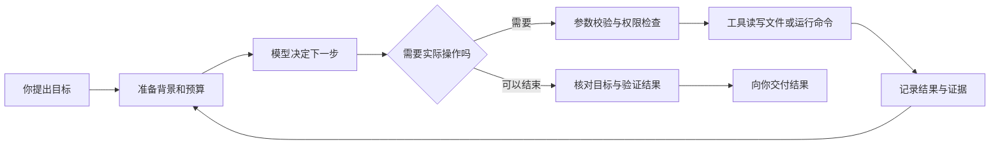

# XhlCLI 源码审查与 Claude Code、Qoder 技术拆解

审查日期：2026-10-16（Asia/Shanghai）。XhlCLI 基线：`1.0.1`，提交 `690a4e17578369c62eef04b5b426e994b8b1d153`。本次只生成审查和研究材料，没有修改业务源码、发布版本或替用户批准新功能。

**核心判断：XhlCLI 已经具备 Coding Agent 的主要骨架，下一步最有价值的工作是把“会执行”变成“执行可信、可以恢复、可以集成”。** 当前优先级最高的是快照恢复、后台任务隔离、取消与超时、上下文压缩的正确性；之后再建设会话运行时、上下文分层和工程证据驱动的审查。

现有测试本次实际运行结果为 **525 项通过，失败 0、错误 0、跳过 0**。同时，额外的离线探针复现了下面 7 项缺陷。二者并不矛盾：现有测试覆盖的行为通过了，这些边界没有被现有断言充分覆盖。

阅读顺序：希望先了解问题，读第 1 节；希望从零理解原理，读第 2～5 节；希望决定下一步做什么，读第 6～8 节。精确发行物、函数偏移和原始验证索引见附录链接。

## 1. 源码审查：需要优先修复的 7 项问题

这里的 P1 表示应在继续扩大自主执行能力前优先处理。所有复现都使用临时目录、假模型或临时数据库，没有调用真实模型，也没有操作用户业务数据。详细探针、运行命令和输出见[验证记录](research-2026-10-16/verification.md)。

### R01：恢复快照可能覆盖工作区外的文件〔P1，已复现〕

位置：`src/main/java/com/xhlcli/snapshot/SideGitManager.java:270`、`:279`。

触发方式：先为工作区中的普通文件创建快照，然后把该路径替换成一个指向工作区外文件的符号链接，再恢复快照。代码仅检查规范化路径是否以工作区路径开头，随后调用 `Files.write`。写入会跟随现有符号链接。

结果：恢复方法返回成功，但工作区外的目标文件被改为快照内容，工作区内的路径仍是符号链接。探针已复现这个结果。

用普通话说：快照记住的是“房间里的文件名”，恢复时却顺着别人后来放上的“快捷方式”，写进了另一个房间。

建议：恢复前检查最终文件和每一级父目录的真实路径；拒绝或安全替换符号链接，明确硬链接处理；在工作区内创建临时文件再原子替换。路径检查还需要考虑检查与写入之间的竞态，不能只增加一次 `normalize()`。保护快照不能代替安全写入。

验收：最终文件软链、父目录软链、普通文件、删除和重建路径分别测试；外部文件内容必须保持不变。

### R02：后台任务可能被另一个工作区的 Agent 执行〔P1，已复现〕

位置：`src/main/java/com/xhlcli/runtime/task/DurableTaskManager.java:234`；`src/main/java/com/xhlcli/cli/ChatBootstrap.java:265`、`:273`。

多个 CLI 默认共用用户目录下的 `tasks.db`。任务表虽然保存 `workspace`，`claimNext()` 却只按 `ENQUEUED` 状态领取；执行器调用的是当前 CLI 已绑定的 Agent，没有按任务工作区建立执行环境。

结果：B 工作区的 manager 可以领取 A 工作区提交的任务。探针证明 B 的 runner 收到了 A 的任务；结合 Bootstrap 的固定 Agent 绑定，实际 CLI 中存在在错误仓库执行操作的风险。

建议：先确定一种明确模型：每工作区独立队列，或者统一调度器按任务记录构建工作区隔离的执行实例。无论采用哪一种，必须把工作区身份贯穿认领、策略、文件解析、模型上下文和快照。

验收：A/B 两个临时仓库同时提交相同文件名的任务，执行根目录、审计、快照和会话都不能串用。

### R03：打开第二个实例会把仍在执行的任务重新入队〔P1，已复现〕

位置：`src/main/java/com/xhlcli/runtime/task/DurableTaskManager.java:55`、`:324`。

构造 manager 时，`recoverRunningTasks()` 无条件把数据库中所有 `RUNNING` 改为 `ENQUEUED`。它没有区分“之前进程已经崩溃”和“另一个进程正在正常执行”。

结果：第一实例被闩锁保持在执行中时，构造第二实例就会改变任务状态；第二实例随后也执行了同一个任务。一次数据库认领事务不能防止这种主动重新入队造成的重复执行。

建议：为任务增加执行者身份、租约过期时间、心跳和领取代次；只回收过期租约。旧执行者提交结果时校验代次，防止已经失去所有权的执行者覆盖新结果。迁移表结构需进入独立设计与兼容性决策。

验收：正常双实例不重复执行，进程死亡后的过期租约能够恢复，旧执行者的迟到完成不能覆盖新状态。

### R04：后台任务显示已取消，仍可能发起模型请求〔P1，已复现〕

位置：`src/main/java/com/xhlcli/cli/ChatBootstrap.java:273`；`src/main/java/com/xhlcli/runtime/task/DurableTaskManager.java:166` 的取消和 Worker 路径；`src/main/java/com/xhlcli/agent/ReactAgent.java:194`。

Bootstrap 为后台执行新建 `CancellationToken`，但任务管理器的取消没有把同一令牌传进去；同时，后台和前台共用 `synchronized ReactAgent.run()`。

结果：后台任务等待前台持有的 Agent 监视锁时，取消可以把数据库状态标为 `CANCELED`，并中断 Worker；等前台释放锁后，该后台任务仍进入模型调用，模型收到的令牌没有取消。探针使用与 Bootstrap 相同的 runner 装配方式和真实 ReactAgent 复现了这条路径。

建议：`TaskRunner` 接收任务身份和取消上下文，取消沿任务→Agent→模型 HTTP→工具进程传播；等待进入执行前再次检查取消。每个后台任务使用独立会话，避免共享前台历史和监视锁。

验收：排队取消、模型流式中取消、审批中取消、工具执行中取消分别覆盖；终态后禁止新模型请求和新工具启动。

### R05：调度器报告工具超时后，真实命令仍继续执行〔P1，已复现〕

位置：`src/main/java/com/xhlcli/parallel/BoundedParallelExecutor.java:135`、`:196`；`src/main/java/com/xhlcli/tool/local/ExecuteCommandTool.java:89`。

`CompletableFuture.orTimeout()` 让等待结果变成超时，不会自动终止底层任务。当前超时分支没有取消传给工具的令牌。`ExecuteCommandTool` 虽然监听令牌并有自己的超时，但调度器和工具是两个不同的计时边界。

结果：调度器先返回 `TIMEOUT`，之后释放临时测试命令的文件闩锁，真实 shell 仍写出了文件。另一个真实 ReactAgent 探针还证明：下一条命令已开始时，上一条被判超时的命令仍可写入，随后出现迟到的成功事件。

建议：为每次工具调用建立独立取消令牌和绝对截止时间；超时后请求取消实际进程及其子进程，并确认清理状态。不能简单取消整轮共享令牌来代替每工具隔离。资源占用必须持续到实际停止，防止“调度上串行、物理上重叠”。

验收：调度超时短于命令自身超时，超时后无迟到写入、无迟到成功事件、无遗留子进程；同资源下一任务只能在前任务停止后启动。

### R06：手动 `/compact` 实际清空会话〔P1，已复现〕

位置：`src/main/java/com/xhlcli/cli/ChatLoop.java:64`，路由入口 `:1005`。

`compactHistory()` 直接调用 `agent.clearHistory()`，然后显示压缩成功；注入的 `ConversationHistoryCompactor` 没有被调用。

结果：用户以为只是整理聊天记录，实际上丢失了当前会话历史。探针通过真实 ChatLoop 输入 `/compact`，确认 `clearHistory` 调用一次、历史归零、摘要器没有调用。

建议：为 Agent 暴露明确的压缩操作；摘要和保留尾部准备成功后再替换历史。命令反馈应说明压缩是否成功及保留了什么，失败时保留原记录。

验收：执行 `/compact` 后，用户约束、未完成任务和最近完整工具回合仍可用于下一轮；`/clear` 才执行清空。

### R07：自动摘要失败仍删除原始历史〔P1，已复现〕

位置：`src/main/java/com/xhlcli/memory/ConversationHistoryCompactor.java:56`、`:69`；调用点 `src/main/java/com/xhlcli/agent/ReactAgent.java:270`。

摘要请求异常被转换成“摘要生成失败：……”字符串，调用方仍把它当作有效摘要，用它替换旧历史。随后 Agent 继续工作；后续正常完成会提交这份已经缺失内容的历史。

结果：8 条测试消息压缩为 6 条，旧消息中的“只修改模块甲”约束消失，只留下摘要失败提示。此处复现使用抛异常的假模型，不需要网络。

建议：返回带成功/失败状态的压缩结果；失败保留原历史，并明确选择重试、可逆的工具输出卸载或可解释停止。摘要请求应共享本轮取消和时间预算，成功后复核总预算再提交。

验收：摘要 API 报错、取消、超时、返回无效摘要时不丢历史；成功摘要保留目标、约束、任务、验证结果和工具配对。

## 2. 先把 Coding Agent 想成一个接工程单的小团队

### 2.1 模型、Agent 程序和工具分别负责什么

假设你说：“给登录接口增加失败次数限制，并运行测试。”

- **模型**负责决定下一步：先找哪个文件、怎么改、结果是否符合目标。
- **Agent 程序**负责组织工作：准备背景、请求模型、检查工具调用、管理循环和停止条件。
- **工具**负责实际动作：查文件、读代码、写补丁、启动测试进程。
- **权限系统**决定动作能不能执行；模型说“允许”不应成为权限依据。
- **事件和会话存储**记下发生了什么，让界面、恢复和外部程序有可靠依据。

Claude 模型和 Claude Code 也是这两层关系。XhlCLI 的 `AnthropicClaudeClient` 能接入 Claude 的模型协议，但这不等于接入了 Claude Code 的全部工具、会话、权限和工作流。



这里每绕一圈，模型都会看到新结果。所谓 ReAct，在这个项目中可以理解为“决定下一步→动手→看结果→继续”。名字并没有赋予它额外的正确性，正确性来自停止条件、协议配对、权限和验证。

### 2.2 常见术语对照

| 术语 | 通俗解释 | 在 XhlCLI 中看哪里 |
|---|---|---|
| Harness / Agent 运行框架 | 包在模型外面、负责让它实际干活的一整套程序 | `ReactAgent`、`ToolExecutor`、上下文和事件模块 |
| Tool Call | 模型提交的结构化操作申请单 | `ToolCall`，包括 ID、工具名、JSON 参数 |
| Observation / Tool Result | 程序给模型的实际执行结果 | `ToolResult`，不能只返回一句“应该成功” |
| 上下文 | 本次请求放在模型面前的资料 | 消息、规则、工具说明、检索结果 |
| Token 预算 | 模型一次能处理的资料空间 | `TokenBudget`；字符估算不等于精确计费 |
| 压缩 | 把过去的细节变成可继续工作的摘要 | `ConversationHistoryCompactor` |
| 长期记忆 | 跨会话保存的稳定知识 | `MemoryManager`；当前由用户明确保存 |
| RAG | 先找相关代码片段，再给模型阅读 | `CodeIndex`、`CodeRetriever` |
| Repo Wiki | 有来源和更新机制的项目说明书 | XhlCLI 可基于现有索引扩展，目前不是现成功能 |
| MCP | 用统一协议连接外部工具和资源 | `mcp` 模块；协议本身不保证工具可信 |
| Skill | 需要时展开的操作说明书 | `SkillRegistry`、`LoadSkillTool` |
| Hook | 程序到特定节点就调用的处理器 | 可考虑的扩展点；不同于给模型的自然语言建议 |
| DAG | 有前后依赖且不能成环的任务图 | `ExecutionPlan`、规划与批次调度 |
| worktree | 同一 Git 仓库的另一个工作目录 | 可用于并行改代码；当前建议能力 |

### 2.3 为什么“回答说成功”不等于“工程任务成功”

一份可靠交付至少需要四部分：修改内容、实际检查命令、退出状态或断言、尚未覆盖的边界。比如模型说“已经测试”，只有在系统记录了它确实运行测试并拿到结果时才有依据。

这个原则也适用于审查代理。XhlCLI 的 Reviewer 当前没有工具，只接收任务描述和 Worker 的文本产出：`TeamOrchestrator.java:146`～`:154`、`:333`～`:335`。它可以检查报告逻辑，却无法独立打开变更和运行结果。这与“审阅者不应改代码”是两回事：审阅者可以拥有只读文件、diff 和测试证据的能力。

## 3. XhlCLI 当前源码怎样工作

### 3.1 从启动到一轮回答

1. `Main`、`CliApplication` 和 `ChatBootstrap` 读取配置并装配对象。
2. Bootstrap 注册本地文件、搜索、命令、Web、浏览器连接、Skill、快照等工具；模型通过工具定义知道可申请哪些动作。
3. `LayeredPromptAssembler` 组合身份、策略、运行环境、项目规则、技能目录等信息。
4. `ChatLoop` 识别 `/plan`、`/team`、`/model` 等命令；普通输入交给 `ReactAgent.run()`。
5. ReactAgent 从已提交历史建立本轮工作副本，挂接取消和整体超时，调用模型。
6. 收到工具调用后校验 ID，按批次调度工具，交给统一执行器，把结果按顺序加回消息。
7. 无工具调用且有最终回答时提交历史，返回终态；达到限制、取消和异常时走相应出口。

关键源码：`ChatBootstrap.java:93`、`:130`、`:189`；`ReactAgent.java:194`、`:262`、`:321`、`:340`。

已有设计值得保留：模型接口与 Provider 适配分离、结构化工具消息、工具调用 ID 检查、取消门、最终提交历史、统一事件、保守工具元数据。这些也是成熟 Agent 需要的基本机制。

### 3.2 工具执行的安全闸门

当前 `DefaultToolExecutor.execute()` 的主要路径是：

```text
检查取消与调用身份
    → 查工具
    → JSON 参数 Schema 校验
    → 路径 / 命令 / 浏览器硬策略
    → 按风险审批
    → 用户改参数后重新校验和检查硬策略
    → 再查取消
    → 执行
    → 审计和结果预算
```

对应 `DefaultToolExecutor.java:83`～`:173`。这条管线比把安全规则只写进提示词可靠，值得作为所有新能力的入口。

需要准确表述边界：`CommandGuard` 是命令模式拒绝规则，`WorkspacePathResolver` 是路径围栏，人工审批是授权决策；它们都不是操作系统沙箱。shell 能执行的语言和程序很多，不能承诺靠命令黑名单完整隔离系统。项目规则也明确禁止把黑名单称作沙箱。

### 3.3 搜索、RAG、记忆分别解决什么问题

以“登录次数限制在哪里”为例：

| 需求 | 首选机制 | 原因 |
|---|---|---|
| 已知 `LoginService` 或接口路径 | `glob_files`、`grep_code`、`read_file` | 精确、便宜、来源容易核对 |
| 不知道名字，只知道业务描述 | `search_code` 的语义与关键词混合检索 | 将自然语言映射到可能相关代码 |
| 想知道模块之间长期关系 | 有来源的项目知识 / Wiki | 缓解每次从零理解架构的成本 |
| 记住团队偏好与约束 | 显式项目规则与长期记忆 | 避免把临时任务内容误当长期事实 |

现有 CodeIndex 具备文件哈希增量处理、Java AST 分块与关系存储；CodeRetriever 合并向量和关键词结果、增加类型权重，并限制同文件结果数量。它已经提供了做项目知识的基础。

但 `VectorStore.search()` 当前把本项目所有向量读出，在 Java 中计算相似度、排序；关键词使用 `LIKE`。这是可用的小规模方案，不能等同于已经具备大规模向量索引或全文检索引擎。`CodeRetriever.hybridSearch()` 也没有因为库里存了关系就自动完成图检索扩展。是否优化，应先用真实仓库测索引耗时、查询 P95、召回和内存。

### 3.4 三种“并行”不要混在一起

- **工具并行**：同一模型回合内，同时读取多个文件。XhlCLI 已有只读与资源冲突判定。
- **任务并行**：任务 A/B 的消息、取消、预算和持久状态各自独立。当前后台装配还共享前台 Agent，R02～R04 是相关缺口。
- **文件系统隔离**：两个执行者修改同一仓库时互不覆盖。独立消息不提供文件隔离，还需资源锁或 worktree。

增加 Worker 数量只能增加潜在并发，不能自动补上后两层。

### 3.5 哪些能力已经有组件，但产品闭环仍有缺口

| 能力 | 代码事实 | 本次审查结论 |
|---|---|---|
| 普通 ReAct 对话与本地工具 | 已接到 CLI，现有测试覆盖主要流程 | 已有可工作的核心，仍需修复超时与上下文边界 |
| 手动压缩 | 命令存在，实际 clearHistory | 不能按“保持目标的摘要压缩”宣传 |
| 自动压缩 | 有摘要器和触发点 | 失败提交、预算复核与取消需要完善 |
| 团队审查 | Planner、两个 Worker、Reviewer；Reviewer 无工具 | 目前是基于 Worker 报告的审查，不是独立验证源码 |
| 后台任务 | SQLite、状态、Worker 已实现 | 多工作区、租约、会话隔离和取消尚需修复 |
| Runtime API | 有回环服务、鉴权、线程表和事件读取 | 在生产源码中未找到 CLI 启动装配；不能声称默认可直接启动真实 Agent 服务 |
| Runtime 的 SSE | 将已存事件一次格式化并关闭响应 | 属于增量事件拉取；尚非持续推送模型 delta 的长连接 |
| 浏览器 | 连接、断开、状态三个工具及策略对象 | 不能等同于已有点击、输入和端到端 UI 操作代理 |
| Skill 与 MCP | 有注册、加载、传输和工具更新 | 可扩展，但仍需要会话生命周期、能力治理和预算配合 |

Runtime 证据：`RuntimeApiServer.java:102`～`:137`；浏览器注册：`ChatBootstrap.java:144`～`:146`。这里区分“类存在”“入口连通”“真实运行验收”，不因文档列出某项能力就自动认定三者都完成。

## 4. Claude Code：值得学的是运行框架的细节

### 4.1 这次实际分析了什么

| 样本 | 获得内容 | 可支持的结论 |
|---|---|---|
| 本机和官方包 `2.1.301` | 原生 Mach-O 主程序身份、包装器、安装器、`sdk-tools.d.ts` | 当前发行身份与类型契约；未还原原生主循环 |
| 官方历史 npm `2.1.19` | 真实压缩 JavaScript `cli.js` | 该历史版本的静态控制流和实现方式 |
| 历史 9 段精确函数切片 | REA 成功解析，保留原文件哈希和字节范围 | 被选中函数的静态结构，不代表全包覆盖 |

当前主体文件即使名叫 `claude.exe`，格式仍是 macOS Mach-O arm64。环境没有可用原生分析引擎，本次没有把包装器分析冒充核心反编译。完整历史 JS 的 REA 解析发生内存不足；之后切片成功，不会抹掉全包覆盖缺口。官方工作原理、子代理、Hook 和恢复说明另见 W01～W04，与制品证据分别使用。

所有实现层面的下述说明默认指 **2.1.19 历史样本**。当前官方文档用于核对产品概念，不能证明当前原生代码沿用了同一函数。详见[Claude Code 证据附录](research-2026-10-16/claude-code.md)。

### 4.2 工具循环：基本原理相同，失败处理更细

历史主循环 `Xv` 串起压缩、模型流、`tool_use`、执行结果和下一轮。工具执行函数 `A$2` 统一处理 Schema、工具自身校验、执行前 Hook、权限、实际调用及执行后/失败 Hook。并发则先问工具及参数是否安全，把连续安全工具成组执行，不安全操作顺序执行。

XhlCLI 不需要复制另一个语言的函数。可直接吸收的设计是：工具的每条入口走同一管线；错误也返回对应工具 ID；模型和工具开始前查取消；执行结果既给模型，也形成可供界面和恢复读取的结构化事件。

### 4.3 上下文：厚资料先入柜，再整理整张桌子

历史样本里可以区分三种处理：

1. **大结果落盘**：全文放文件，模型看到简要内容和可以取回的引用。
2. **微压缩**：处理较旧工具结果，同时保护较新、仍有用的结果。
3. **完整摘要**：提炼会话，并恢复继续工作需要的文件、任务和 Hook 等附件。

用例：一次测试产生数万行输出，模型当前只需要失败测试名、错误位置和少量上下文。完整日志仍保存，后续需要时按范围查阅。这样既减少上下文，也保留证据；单纯截断则可能把关键失败信息永久丢掉。

对 XhlCLI，优先修复 R06/R07，再让 `ToolResultBudget` 的截断结果带全文引用，最后统一核算系统提示、技能、记忆、工具 Schema、检索与历史预算。当前 `ContextAssembler` 主要拼接内容，自动压缩触发只检查 `pure` 历史，不能据此承诺最终请求总量一定不超限。

### 4.4 子代理：给同事独立任务单、工具箱和取消按钮

历史子代理路径 `tC` 建立自己的消息、身份、工具集合、模型配置和记录，处理取消与连接清理；基础工作仍复用 Agent 主循环。

值得参考的不是固定安排几个角色，而是把执行上下文做成明确边界：目标、工具白名单、工作目录、历史、预算、取消、输出和证据。主代理只接收需要的汇总，避免把所有测试日志和资料全文都放回主会话。

当前 `2.1.301` 类型文件还声明了后台 Agent、worktree、任务依赖、持久定时任务、监控、可恢复 Workflow 等形状。这些可以产生研究线索，但类型声明存在不等于账号默认可用，也不等于本次验证了对应运行行为。

### 4.5 Skill、Hook、MCP 的职责

Skill 告诉模型“这类工作怎么做”；Hook 在程序节点执行确定的处理；MCP 连接外部能力。三者可以配合，但互不替代。

例如：“修改后请测试”写在 Skill 中，仍可能被模型漏掉；若工具完成后系统记录变更并要求交付阶段具有测试证据，才形成可检查的规则。Hook 若能改变输入，还需明确后续重新校验和权限规则，不能悄悄绕过硬策略。

## 5. Qoder：把运行时、知识和宿主扩展连接起来

### 5.1 先更新产品基线

截至本报告日期，官方公告写明 **Qoder IDE Quest 窗口于 2026-10-15 23:59（UTC+8）退役**，Editor 的 AI Chat、Agent 和 Expert 不受该公告影响。因此，旧 Quest 窗口适合作为历史交互参考，当前对照重点放在 Qoder CLI、Agent SDK 和仍适用的能力机制。[W07]

本次真实制品为官方 npm **`@qoder-ai/qodercli@1.1.72`**，包发布时间为 2026-10-15。它包含大型 JS bundle、worker runtime、内置 Skill 和协议文件。完整 bundle 的 REA 解析内存不足；对精确选出的 9 个完整函数/方法切片再次分析，9 个文件解析成功，4,344 个 AST 节点，零解析失败。由此得到的是限定代码路径的静态证据，未运行 Qoder 登录或模型任务。

不能把 CLI 包称为完整 IDE 开发源码，也没有获得 Qoder 服务端或 Repo Wiki 独立组件全部内部实现。详见[Qoder 证据附录](research-2026-10-16/qoder.md)。

### 5.2 SDK 与 CLI：一个当插座，一个当发动机

官方 SDK 文档将职责划为：应用程序提供输入、选项、权限回调并消费事件；Qoder CLI 负责模型、工具、会话与任务执行。[W09]

发行包静态代码中，宿主初始化、能力快照、就绪与 SessionStart 的路径也支持“宿主与运行时有明确协议边界”这一判断。它并不证明每一种宿主都已启用相同能力。

XhlCLI 已有 `AgentRunner`、`RunEvent` 和 Runtime API 组件，适合向这个方向收敛：让终端只是一个宿主，脚本、IDE 或本地页面也使用同一执行服务。前提是先把任务身份、隔离、取消和事件接通，不能每增加一个界面就另写一套 Agent 逻辑。

### 5.3 长期记忆：先找需要的，再放进上下文

Qoder worker 的选中路径展示了记忆获取、提醒块注入，以及 AutoDream 的节流、锁、受限子任务和完成后处理。这是具体静态路径证据；“默认开启”“每轮必然执行”“最终知识质量”均未在运行时验证。

普通话解释：一个人工作完，可以把稳定经验整理进笔记；下一次先看相关笔记。但把每一句临时讨论都保存下来，会让笔记越来越乱，甚至把错误结论变成长期规则。

XhlCLI 当前约定长期记忆由用户明确保存，应该保留这一产品边界。可以先增加可审阅的“候选记忆”：展示来源和理由，用户保存后生效；自动写入是否开放，需要后续独立决定。记忆也应有工作区范围、版本、来源、失效与删除机制。

### 5.4 Repo Wiki：项目说明书需要跟着代码更新

官方 CLI 文档说明 `qoder wiki` 会准备独立 Wiki 组件，在本机组织 Agent 处理规划、代码检索和文档生成；该过程需要认证与网络。[W08] 本次没有下载和逆向该独立组件，所以其检索排序、更新算法和服务交互细节仍未知。

值得参考的产品想法：让项目说明具有代码来源、文件版本和更新状态。XhlCLI 已有 SHA-256 增量索引、Java AST 和关系存储，适合先做 Java 项目的小范围知识页，而不是承诺一次生成永远正确的全仓库百科。

一张可用知识页应回答：这个模块做什么、入口在哪、依赖谁、怎么验证、依据哪份代码。代码变了，旧页面应被标为过期，再按需更新；人工补充要有保护标记。

### 5.5 插件与工作流：优先固定协议，再开放组合

选中插件代码展示 manifest 中 commands、agents、skills、hooks 和 MCP 配置的加载/合并。官方工作模式还区分 Plan、Goal、定时任务、循环、Workflow 和 Headless。[W10]

XhlCLI 可以先做少量有价值的流程，例如“复现→修改→测试→只读审查”，并让每一步保存状态和证据。等恢复、取消、权限和版本契约成熟，再决定是否需要开放工作流描述格式。先造一个通用 DSL 并不能解决执行可信度。

## 6. 功能对照：已有骨架与真正差距

标记说明：**源码**为当前 XhlCLI 代码；**制品**为上述指定版本静态观察；**文档**为访问当日官方说明；**建议**表示尚未实现。不同证据不互相升级。

| 领域 | XhlCLI 当前事实 | Claude Code 参考 | Qoder 参考 | 优先行动 |
|---|---|---|---|---|
| Agent 循环 | 源码：结构化循环、限制、事件、提交历史 | 历史制品：同类循环与更细失败处理 | 制品/文档：宿主协议与工具循环 | 保留核心，补取消/超时一致性 |
| 工具权限 | 源码：统一执行器、硬策略、审批和审计 | 历史制品：统一校验、Hook、权限和结果 | 制品：权限/Hook 控制面 | 所有入口复用同一执行权限上下文 |
| 上下文 | 源码：预算、摘要器，但存在 R06/R07 | 历史制品：落盘、微压缩、摘要恢复 | 制品：记忆注入；文档：分层上下文 | 失败可恢复、全文可取回、总预算复核 |
| 子代理 | 源码：固定 Planner/Worker/Reviewer | 历史制品：独立上下文和工具集合 | 制品：受限子任务与宿主边界 | 独立会话与只读 Reviewer |
| 后台任务 | 源码：队列存在，隔离/租约/取消有缺陷 | 当前类型：异步状态、统计、输出文件 | 文档/制品：多种任务与控制模式 | 先修生命周期，再扩展后台化 |
| 会话恢复 | 源码：快照、历史与 Runtime 存储分散 | 历史制品：子链记录；当前文档：会话恢复 | 文档：resume、fork、结构化事件 | 统一会话与事件，不把快照当聊天恢复 |
| 知识 | 源码：Java AST、增量索引、混合检索、显式记忆 | 文档：项目规则与自动记忆 | 制品：记忆整理；文档：独立 Wiki | 有来源、可失效的 Java 项目知识 |
| Skills/MCP | 源码：已有目录和工具接入 | 历史制品：按需加载、子代理连接清理 | 制品：插件 manifest 组合 | 先做能力白名单、发现与清理 |
| 外部集成 | 源码：Runtime 组件，默认入口未接通 | 当前类型/官方文档：可编程接口线索 | 文档：SDK 调用 CLI runtime | Headless 与事件协议最先形成闭环 |
| 操作系统沙箱 | 源码：未实现，现有是策略围栏 | 文档能力须按宿主单独核对 | 文档能力须按宿主单独核对 | 按项目现有排除项，另行 PRD 决策 |

## 7. 改进与拓展路线：按收益、成本和依赖排序

以下是候选路线，没有冻结 Phase 19 范围。工作量为相对估计，未承诺工期；应在确定验收和兼容性后再拆实施计划。

### 第一批：先让现有能力可信

| 顺序 | 建议 | 收益 | 成本 | 依赖与验收 |
|---|---|---|---|---|
| 1 | 修复 R01 快照写入边界 | 防止恢复越界覆盖文件 | 中 | 软链/硬链/父目录与竞态策略明确，外部内容不变 |
| 2 | 修复 R02/R03 任务工作区与租约 | 防止错仓库执行、重复执行 | 中至高 | 数据库迁移设计；双实例和崩溃恢复测试 |
| 3 | 修复 R04/R05 取消与实际停止 | 防止取消/超时后继续动作 | 中至高 | 取消树、截止时间和进程树清理；禁止迟到副作用 |
| 4 | 修复 R06/R07 压缩语义 | 长会话不因整理或服务故障丢约束 | 中 | 两条命令/失败回归与真实 Agent 假模型集成 |
| 5 | 校准能力声明与验收矩阵 | 让文档中的“已交付”对应真实入口 | 低至中 | Runtime、浏览器、Reviewer 分清组件与产品能力 |

### 第二批：补一条可恢复、可集成的任务主线

**候选 A：统一会话运行时和 Headless 接口。收益高，成本中至高。**

最小版本只需明确 `sessionId`、`runId`、`taskId`、`workspaceId`，每任务独立历史、取消、预算和事件；终端与后台共用服务层。再增加脚本入口，输出稳定 JSON/JSONL 事件和退出状态。新参数、事件协议及会话格式都属于待设计公共契约，本文不把它们当作现有命令。

验收：重启后能恢复会话；A/B 任务不串历史；取消有实际停止证据；假模型的事件序列可重放；Headless 需要审批时按明确策略拒绝；API/CLI 对同一任务得出相同终态。RunEvent 需要覆盖关键执行证据，但不能仅靠模型重放保证外部副作用幂等。

**候选 B：大输出存储与分层上下文。收益高，成本中。**

为工具全文建立有大小、过期、脱敏和范围控制的存储，返回预览、内容哈希和检索/分页引用。压缩保留任务状态，重新注入必要规则；在最终 Provider 请求前统一核算全部内容。减少输入可能降低模型开销，但节省幅度需要实测。

验收：大测试日志仍可定位全部失败；压缩失败可恢复；工具调用配对不破；摘要后仍遵守原约束；统计压缩前后输入量与任务成功率。

**候选 C：有证据的只读 Reviewer。收益高，成本中。**

让 Reviewer 能读取当前 diff、相关文件和测试产物，限制为只读工具。Worker 交接包应包括变更文件、验证命令、结果和未覆盖项。审查结果引用具体证据，验证通过由系统的执行记录支持。

验收：Worker 故意声称“测试通过”，但证据显示失败时，Reviewer 能指出冲突；仅修改提示词而未接通工具不算完成。

### 第三批：从 Java 项目理解做出差异

**候选 D：带来源和过期检查的 Java Repo Wiki。收益中至高，成本中至高。**

复用 AST、CodeIndex、文件哈希与关系表，先生成模块入口、关键类型、调用关系与验证方式。每页记录相关文件哈希与生成版本；代码改动后标记过期，只重建受影响页；人工段落保留。

验收：修改方法签名后能找到受影响页面；知识回答可追到当前代码；过期页有明确提示；禁止仅凭陈旧摘要自动修改文件。第一版不承诺所有语言、所有构建系统和全项目完整语义。

**候选 E：Java 工程诊断工具。收益高，成本中。**

为 Maven/Gradle 构建、JUnit 结果、编译错误建立结构化适配，输出失败测试、堆栈位置、模块和退出状态；和 diff/Reviewer 连接。先从现有 Maven/JUnit 项目实现，Gradle 支持单独界定。

验收：相同任务能区分“未运行”“执行失败”“断言失败”“环境失败”；只修复目标模块后运行适用检查；原始日志有引用。

**候选 F：少量确定性 Hook 与项目能力包。收益中，成本中。**

先限定执行前、执行后、失败、压缩等必要事件，定义 JSON 输入输出、超时、允许动作和错误策略。插件目录组合 Skill/MCP/规则时，保持硬权限不被文案或 Hook 放宽；不急于开放任意自动安装市场。

### 暂不优先的拓展

| 方向 | 暂缓原因 | 再评估条件 |
|---|---|---|
| 通用 Workflow DSL | 状态、恢复和取消仍未稳定，先造语言会放大复杂度 | 两三个固定流程已验证重复收益 |
| 云端多租户与远程执行平台 | 超出现有产品边界，增加隔离、部署和凭据风险 | 有明确用户与独立产品决定 |
| 容器 / microVM 沙箱 | 项目当前明确排除，需要独立 PRD | 确认宿主支持、权限、成本与安全目标 |
| 默认自动长期记忆 | 与当前“用户明确保存”约定冲突 | 用户决定写入、审批、删除与隐私边界 |
| 盲目增加 Worker / 模型角色 | 可能只增加成本和共享写冲突 | 对照试验证明成功率或时延收益 |
| 复刻旧 Quest 窗口 | 当前产品入口已经变化 | 只借鉴经过验证的协作机制 |

如果下一阶段只选一个范围，建议选“**可信任务生命周期**”：把 R01～R07 修复与回归验证做完，再决定是否把会话运行时作为下一阶段。不要把本报告所有建议一次塞进一个 Release。

## 8. 怎样判断优化真的有收益

建立小而固定的项目任务集，同一提交、同一模型配置与预算下比较，保留失败任务。可以从现有 Golden Set 继续扩展，而不是只增加“能找到关键字”的测试。

| 维度 | 应记录的指标 | 能回答的问题 |
|---|---|---|
| 完成质量 | 真实构建/测试、隐藏约束、修改范围 | 功能是否完成，是否误改 |
| 生命周期 | 取消后新请求数、超时后副作用、重复任务数 | 系统是否真的停下、是否重复干活 |
| 上下文 | 输入量、压缩次数、失败后保留率、工具全文取回率 | 节省空间是否以丢信息为代价 |
| 检索 | 相关文件召回、查询 P95、索引耗时与内存 | RAG/Wiki 是否比精确搜索更有价值 |
| 多代理 | 相对单代理成功率、时间、用量、冲突和重试 | 分工是否值得成本 |
| 用户体验 | 审批次数、恢复成功率、用户纠正次数 | 是否更可控、能否放心继续工作 |

不能用“模型自评通过”替代这些指标。也不应把本次 525 项通过升级为新路线已经验证，更不能把静态竞品观察当成本项目的测试结果。

## 9. 证据、版本和调查范围

### 9.1 本地与发行物证据

- [原始提示词诊断与优化稿](research-2026-10-16/optimized-prompt.md)
- [XhlCLI 验证命令、探针与覆盖范围](research-2026-10-16/verification.md)
- [Claude Code：版本、哈希、REA Evidence、精确函数范围](research-2026-10-16/claude-code.md)
- [Qoder：版本、哈希、REA Evidence、精确函数范围](research-2026-10-16/qoder.md)
- [证据清单](research-2026-10-16/evidence-index.json)

本次读取源码树并重点追踪 Agent、工具、权限、上下文、团队、后台任务、快照和 Runtime 的关键路径；没有声称逐行穷尽审计全部 223 个生产 Java 文件。137 个测试 Java 文件由现有测试入口执行。原始第三方制品和完整 REA 结果单独留存在本机研究目录，未把厂商 bundle 导入项目源码。

### 9.2 官方资料索引

访问日期均为 2026-10-16。资料通过 agent-reach 的 Exa/Jina/GitHub 路由获取；Exa 后续遇到免费额度限制，网页阅读改用 Jina。Context7 用于补充核对 Claude 上下文官方文档。网页说明是产品说明证据，与静态制品观察分开使用。

| 编号 | 官方资料 | 地址 |
|---|---|---|
| W01 | Claude Code 工作原理 | `https://code.claude.com/docs/en/how-claude-code-works` |
| W02 | Claude Code 子代理 | `https://code.claude.com/docs/en/sub-agents` |
| W03 | Claude Code Hook | `https://code.claude.com/docs/en/hooks` |
| W04 | Claude Code 快照与恢复 | `https://code.claude.com/docs/en/checkpointing` |
| W05 | Qoder CLI 工具循环、权限和上下文 | `https://docs.qoder.com/cli/how-it-works.md` |
| W06 | Qoder CLI 记忆层次 | `https://docs.qoder.com/cli/how-memory-works.md` |
| W07 | Qoder IDE Quest 退役公告 | `https://docs.qoder.com/release-notes/quest-retirement-notice.md` |
| W08 | Qoder CLI Repo Wiki | `https://docs.qoder.com/cli/repo-wiki.md` |
| W09 | Qoder Agent SDK 职责与接口 | `https://docs.qoder.com/cli/sdk/overview.md` |
| W10 | Qoder CLI 工作模式 | `https://docs.qoder.com/cli/working-modes.md` |
| W11 | Qoder CLI 内置能力目录 | `https://docs.qoder.com/cli/built-ins.md` |
| W12 | Qoder 官方文档索引 | `https://docs.qoder.com/llms.txt` |

网页可能继续更新，引用时应同时保留访问时间；发行包结论则固定到具体版本和哈希。

### 9.3 原始问题完成检查

| 用户要求 | 完成情况 | 边界 |
|---|---|---|
| 使用 prompt-optimizer 优化提示词后开始 | 已完成 | 保留完整稿和简版；执行由 vibe-workflow 负责 |
| Review XhlCLI 源码 | 已完成重点路径审查 | 7 项缺陷有离线复现；非穷尽式审计 |
| 使用 agent-reach 获取竞品资料 | 已完成 | 官方技术资料为主；没有把无后端社媒写成已调研 |
| 使用 REA 逆向 Claude Code | 部分回答当前内部，已回答历史指定路径 | 当前原生主循环未知；历史 JS 和当前类型契约有证据 |
| 使用 REA 逆向 Qoder | 已回答 CLI 指定路径 | 大 bundle 全解析失败；切片成功；IDE/服务端/Wiki 核心未知 |
| 通俗中文技术讲解 | 已完成 | 概念、实例、流程图和三者对应代码 |
| 可参考优化与项目拓展 | 已完成候选路线 | 未批准新 Release，也未实施建议 |
