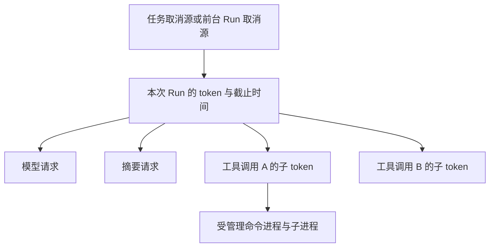

# v1.1 拟议技术设计

状态：`PROPOSED`，尚未实施或批准。目标 Release：`v1.1`（预计 `v1.1.0`）。日期：2026-10-16。

关联 [需求](../prd/v1.1-trusted-task-lifecycle.md) 的 REQ-01～REQ-08、AC-01～AC-13。本文件是目标方案；[现有技术设计](../TECH_DESIGN.md)仍需结合当前源码和[审查证据](../engineering/research-2026-10-16/verification.md)理解。

## 1. 已核验的现状与选择

| 问题 | 现有入口 | 本批选择及理由 |
|---|---|---|
| R01 | [SideGitManager](../../src/main/java/com/xhlcli/snapshot/SideGitManager.java) 的 `writeTargetTree` 与删除逻辑 | 恢复计划与安全文件操作分开；禁止沿链接原地写入，检查覆盖写入、删除和目录清理 |
| R02、R03 | [DurableTaskManager](../../src/main/java/com/xhlcli/runtime/task/DurableTaskManager.java) 的全局库、领取、启动恢复 | 保留一个任务库，加严格工作区过滤与真实租约；避免拆库搬运全部历史记录 |
| R04 | [TaskRunner](../../src/main/java/com/xhlcli/runtime/task/TaskRunner.java) 仅接收 prompt；[ChatBootstrap](../../src/main/java/com/xhlcli/cli/ChatBootstrap.java) 复用前台 Agent 并新建 token | 每任务独立执行上下文和 Agent，manager 持有取消源，跨实例取消持久化 |
| R05 | [BoundedParallelExecutor](../../src/main/java/com/xhlcli/parallel/BoundedParallelExecutor.java) 只完成超时 Future | 分离返回结果与真实执行退出；对每次工具调用管理 token、deadline 和清理确认 |
| R06、R07 | [ChatLoop](../../src/main/java/com/xhlcli/cli/ChatLoop.java) 清空；[Compactor](../../src/main/java/com/xhlcli/memory/ConversationHistoryCompactor.java) 将异常文本当摘要 | 统一 Agent 压缩入口，生成候选、校验后一次提交；失败保留原文 |

不引入会话数据库、进程常驻服务、插件总线或新的 Provider。新增内部类型只服务本批生命周期问题。

## 2. 安全快照恢复（REQ-01，AC-01、AC-02）

### 2.1 先生成完整恢复计划

从 Git 树读取路径、对象与文件模式，不能继续只保留 `path→ObjectId` 而丢失类型。生成写入、删除、建目录与清理列表；拒绝绝对路径、`..` 越界、保留目录、非法模式及与排除项冲突的操作。读取工作区规范根并检查父级和最终项，不跟随软链；建议本批遇软链、子模块及特殊文件即拒绝本次恢复，不擅自转换成普通文件。

所有可预知错误在第一次工作区修改前检出。保留已有 Pre-Restore 快照；预检失败不得先删一部分文件。执行中 I/O 失败则返回失败、已执行列表、未执行列表及保护快照 ID，不自动进行第二次破坏性回滚，也不宣称多文件原子事务。

### 2.2 安全写入与竞态

- 新增窄接口 `SafeRestoreFileOps`，所有恢复写入、删除、建目录、空目录清理走同一边界。预检和实际操作均检查，不能以再次 `normalize/startsWith` 作为竞态防护。
- 在可信父目录中创建唯一临时普通文件，写完后以安全替换完成；不截断现有文件，因此硬链接别名的外部内容保持不变。拒绝软链目标，不用“删除再普通写入”制造新的跟链窗口。
- 使用目录句柄锚定的、不跟随链接的操作能力，优先验证 Java NIO `SecureDirectoryStream` 与实际文件系统提供的移动/替换语义。逐层目录创建、目标已存在时的替换、父目录置换均需能力探针；不能仅凭 API 名称宣称解决竞态。
- 文件系统缺少安全操作能力时拒绝恢复，并给出可理解的原因；不得静默退回 `Files.write(path)`。安全支持矩阵和是否需平台专用实现属于 D01，须先用小型能力验证确定，不能用有竞态的兼容降级换“跨平台通过”。
- 恢复与受管理的工作区写工具按规范工作区身份共享协作锁：进程内互斥配合跨实例文件锁，锁的生命周期覆盖真实执行及清理，避免本产品自身同时改同一批文件。进程退出后文件锁可能释放，遗留子进程仍需过期任务隔离策略兜底；该锁不能阻止编辑器或任意第三方进程，也不构成操作系统沙箱。竞态测试必须交换真实路径，不能只 mock 路径校验。

## 3. 工作区、持久任务与租约（REQ-02、REQ-03）

### 3.1 工作区身份与执行绑定

新增内部 `WorkspaceIdentity`：由存在的项目根 `toRealPath()` 产生规范根与稳定 `workspace_key`；真实路径字符串是核验来源，哈希仅用于索引。根目录别名归一；不同 Git worktree 仍按各自真实根隔离，不以 remote URL 合并。不存在、不可读或身份不匹配时拒绝执行。

manager 启动必须显式传入身份，删除生产装配中依赖 `Path.of(".")` 的隐含绑定。`enqueue/list/find/cancel/claim/recover` 全部带相同 `workspace_key` 条件，知道任务 ID 也不能越过隔离。旧构造入口若保留兼容适配，也须推导并校验身份，不允许无作用域查询进入生产。

`TaskRunner` 改为接收任务执行上下文（taskId、规范根、claimEpoch、token、deadline），返回结构化状态；不能只截取 `RunResult.finalAnswer()` 丢弃 FAILED/CANCELED。任务启动前创建独立 Agent、历史、预算、记忆视图、快照和工作区工具；可共享无状态客户端配置，不能共享前台 Agent 的可变会话。后台审批采用非交互安全策略，不能绑定前台输入框。关闭任务级资源，避免每个任务泄漏线程或 MCP 进程。

### 3.2 Schema 提案与数据语义（D02，待评审）

实际表是 `runtime_tasks`，现有列包含 `id/status/prompt/workspace/result/error/created_at/started_at/finished_at/updated_at/duration_ms`；无 owner、租约字段或版本门禁。当前数据量和遗留工作区质量未知，迁移前只读统计，不预设为空库。

保留现有表、主键与六个状态字符串，建议增加：

| 字段 | 类型、空值与初始值 | 含义与写入方 |
|---|---|---|
| `workspace_key` | TEXT，可空，遗留未知时为 NULL | 新任务必填；manager 的全部操作按其隔离；NULL 历史只供显式诊断，不自动领取 |
| `owner_id` | TEXT，可空，默认 NULL | 实例随机标识，成功认领时写入，终态后可清空 |
| `claim_epoch` | INTEGER，非空，默认 0，非负约束 | 每次成功领取加 1；旧 worker 写回必须携带同一代次 |
| `lease_expires_at` | INTEGER，可空，默认 NULL | UTC 毫秒到期点；仅 owner 有权续约 |
| `cancel_requested_at` | INTEGER，可空，默认 NULL | 当前工作区的任一实例可以设置，重复请求保留首次时间 |
| `cancel_ack_at` | INTEGER，可空，默认 NULL | owner 完成执行清理后写入；不能把租约过期当作已停止证明 |

索引建议为 `(workspace_key, status, created_at)` 与 `(workspace_key, lease_expires_at)`。无新外键；`workspace_key` 不另建全局工作区注册表。任务保留期沿用现有行为，不新增自动清理；prompt/result/error 的敏感性不因迁移改变，不额外记录凭据或模型全文日志。取消字段需通过 `DurableTask` 和 CLI 格式化器显示，但不扩展未装配的 Runtime 公共协议。

认领使用短写事务与状态条件更新，只有受影响行数为 1 才获得执行权；禁止长时间持事务调用模型。续约、完成、失败、取消确认同时校验 `id + workspace_key + owner_id + claim_epoch + 当前状态`，续约还需未过期。初始建议租期 30 秒、心跳 5 秒，使用可注入时钟与调度器测试；实际数值在故障注入后确定，不新增用户配置面。

DB 中时间用于跨实例租约，进程内超时使用单调时间。时钟大幅回拨、续约失败或过期时，owner 失去执行资格并触发取消，不继续开模型/工具；执行启动与结果提交都复核资格。持久租约能阻止迟到状态覆盖，不能单靠 fencing 阻止已发出的 shell 命令写文件。

### 3.3 过期恢复与重复执行边界

健康 RUNNING 保持不变；移除构造器中“所有 RUNNING 改回 ENQUEUED”的逻辑。过期扫描只处理当前工作区，且与 owner 更新竞争时必须条件提交。

**推荐 D02 策略**：过期 RUNNING 标记为失败且明确“执行结果不确定，需检查工作区”，保留历史结果和 owner 诊断；不自动重新执行任意有副作用 prompt。未确认旧执行停止前，相关工作区写入保持隔离，不能因记录 FAILED 就释放仍占用的执行锁。任务若已请求取消但 owner 消失，显示“停止未确认”，不填 `cancel_ack_at`。

恢复执行由用户检查后重新提交现有 `/task add` 完成；本批不增加 resume/retry 命令。若要选择自动重排，则必须先设计可恢复检查点、幂等副作用与跨进程停止证明，超出本批默认推荐。不能承诺通用任务恰好执行一次。

### 3.4 迁移、兼容窗口与恢复

1. 要求停止全部旧版写入者并确认没有遗留任务进程；旧版没有 Schema 门禁，不能靠新版字段阻止其继续写。禁止混用新旧 worker。
2. 在独占维护窗口统计数据量、工作区分布与 NULL/无效路径；通过 SQLite 一致性备份产生可验证副本，记录行数与校验结果，不直接复制仍活跃的主 DB 而忽略 WAL。
3. 以单事务升级至 `PRAGMA user_version=1`：新增字段、约束与索引；能确定真实根的记录回填身份，不能确定的记录保留并隔离。旧 RUNNING 不能恢复为可执行队列，按已批准的过期/不确定策略处理。
4. 提交前后核对 ID 集合、行数、prompt/result/error 与完整性；失败回滚事务。新版只接受已知版本，未知更高版本拒绝启动；重复打开不得二次迁移或重排健康任务。
5. 回退须停止新版及其受管理进程，再验证并恢复升级前备份。升级后产生的新任务先导出留存，备份回退无法自动合并它们，不允许直接启动旧版读取新库或静默丢掉新增记录。迁移失败且未提交可直接保留原库。

迁移体积、锁等待和备份空间须按实际样本测量；本轮只形成方案，不打开用户真实任务库执行升级。

## 4. 取消树与工具实际停止（REQ-04、REQ-05）

### 4.1 取消关系

复用 [CancellationToken](../../src/main/java/com/xhlcli/llm/CancellationToken.java) 的回调注册与注销，补足父子链接与每调用独立取消源。manager 先登记 token 再进入可等待的执行步骤，排队取消也能命中；在拿到 Agent 执行资格之后、模型请求之前再次检查。任务 deadline 与 Run/工具 deadline 取较早值，过期调用不能启动。

跨实例 `/task cancel` 先持久化请求，owner 的心跳/取消监听读取后调用同一 token。本实例也立即触发；正常调度条件下跨实例传播应在一个轮询周期内开始，测试使用可控调度器。终态 CAS 与取消请求竞争：完成先提交则取消返回已结束；请求先提交则成功结果不能覆盖它，待清理后确认 CANCELED。

排队任务未启动可直接取消；RUNNING 保持状态并展示“取消中”，只在执行退出与清理完成后填取消确认。`close()` 先触发取消，在同步锁之外等待执行退出，再关闭连接，避免持 manager 锁等待 worker 导致收尾死锁。无法退出时记录清理未完成并阻止后续冲突工作，不能吞异常并显示成功。

### 4.2 调度与进程清理

为每次调用创建内部 `ToolExecutionHandle`：持有子 token、实际任务句柄、结果槽、退出确认和资源占用。`Future.cancel` 或结果 TIMEOUT 仅为请求，不能用 `Future.isDone()` 证明执行线程已退出；退出确认由任务 `finally` 与资源清理共同完成。

串行、单工具、并行路径共用该生命周期。计时从调度接受调用开始，排队到期先取消，实际执行前复核。超时只停止该子调用；父 Run 取消停止全部子调用。独立兄弟任务可完成，但同一资源上的后继必须等待清理。若工具不响应取消，停止该 Run 后续调度并保留占用/隔离标记；不使用 `Thread.stop`，不以无限等待伪装成功。

[ExecuteCommandTool](../../src/main/java/com/xhlcli/tool/local/ExecuteCommandTool.java) 需登记父子进程，取消后停止输出接收、请求终止、等待宽限期、必要时强制终止，再确认进程退出并关闭读线程和流。仅 `destroyForcibly()` 根 bash 不足以证明子进程停止。进程组/进程树策略需在实际支持平台验证；脱离进程树或远端已受理请求不能由 Java token 自动撤销，无法证明停止就必须报告限制并阻断相关继续工作。

工具结果只允许提交一次。超时/取消胜出后，默认工具执行器和 Run 事件门禁均拒绝迟到的成功结果、历史提交及用户成功提示，审计记录超时与清理结果。禁止把关闭事件当作阻止真实文件写入的替代方案。

## 5. 可靠压缩（REQ-06、REQ-07）

新增结构化 `CompactionResult`：成功、无需压缩、失败、取消、超时，携带候选消息、前后估算值及安全原因码；失败不返回伪造摘要。手动和自动入口都调用相同内部流程：

1. 对已提交历史取不可变快照和版本号，保留原始系统安全层；按完整 assistant 工具调用及其全部 tool results 选择切分点，不按任意消息条数硬切。
2. 使用当前 Provider、所属操作 token 和剩余 deadline 生成摘要候选。手动操作也注册到 CLI 可取消操作，不偷偷创建不受管理 token。
3. 校验响应状态与结构：目标、约束、已完成、未完成、变更、验证、下一步等字段存在；拒绝空响应、工具调用、无效格式或错误响应。对无对应信息的字段允许明确为空，不能把缺字段当正常。模型摘要不提升权限或替换原始系统规则。
4. 组装“摘要＋完整近期回合”，连同系统/记忆/检索/技能/工具 Schema 及输出保留重算最终请求估算。沿用当前估算器，不能仅检查 `pure` 历史；避免对预留预算重复扣减。候选必须有实际压缩收益且满足本地预算，不满足则不提交。
5. 提交前重查取消、时间、历史版本与 Provider/预算版本，一次替换。失败、取消、版本变化都保留原历史；自动路径仍超预算则明确失败，不循环压缩或直接发送超限请求。

`ReactAgent` 负责历史提交；`ChatLoop /compact` 只展示结果，不调用 `clearHistory()`。接口的新增方法须同步适配现有 Agent 抽象、实现和测试替身。`/clear` 保持独立，摘要调用失败不顺带写长期记忆。

## 6. 能力声明校准（REQ-08，AC-13）

| 能力 | 当前证据边界 | 本批应采用的表述 | 本批不新增 |
|---|---|---|---|
| Runtime | `RuntimeApiServer` 有组件/契约测试，生产 CLI 未装配；事件请求读已存记录后关闭，delta 在 runner 完成后追加 | 本地 Runtime API 组件及有限事件读取；生产入口与实时性限制明确 | 常驻启动参数、SDK、实时长连接 |
| 浏览器 | Agent 工具为 connect/disconnect/status，CLI 可查看标签信息 | CDP 连接、状态与标签信息能力；已有 guard 是策略组件 | 点击、输入、导航等完整自动化闭环 |
| Reviewer | 无独立工具，只评 Worker 提交文本 | 对 Worker 文本做结构化审查与有限重试 | 独立读取源码、diff 或执行测试 |
| 安全与可靠性 | R01～R07 已有失败证据；路径/命令策略不等于 OS 隔离 | 描述已核验围栏及实际验收范围 | 绝对沙箱、任意任务无损恢复或恰好执行一次承诺 |

实施时逐项核对 README、TECH_DESIGN、PROJECT、ROADMAP、CLI 帮助、官网及相关评测入口；当前文档添加审查纠正说明，历史 Release 物证保持封存。计划表述指向本批文档，不能把规划当已交付。

## 7. 实施前需闭合的具体决定

| 编号 | 选项与推荐 | 影响及恢复 | 当前状态 |
|---|---|---|---|
| D01 安全恢复支持边界 | 推荐禁止恢复路径软链/特殊树项，硬链通过替换隔离；先验证句柄操作能力，不支持时拒绝；备选是增加平台专用实现，需另评维护成本 | 可能收紧过去“可恢复”的目录/平台；保留保护快照，拒绝时不写入；不能以不安全兼容路径回退 | 待能力验证与方案评审 |
| D02 任务 Schema 与崩溃恢复 | 推荐本节加字段、维护窗口升级、遗留未知任务隔离、过期执行标为结果不确定且不自动重跑；备选为拆工作区库或幂等检查点恢复，后者扩大范围 | 禁止新旧 worker 混跑；保留备份与升级后新记录，回退须停全部进程；改变旧版自动重排语义 | 待具体迁移方案评审 |

用户已授权本批规划。以上尚未展示并接受的兼容/数据决定不冒充批准；后续实施先完成能力验证与只读迁移调查，再对具体结果评审。普通类拆分、命名和测试组织无需新增批准。无新增付费服务、网络数据传输或权限放宽。
